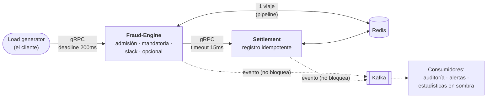
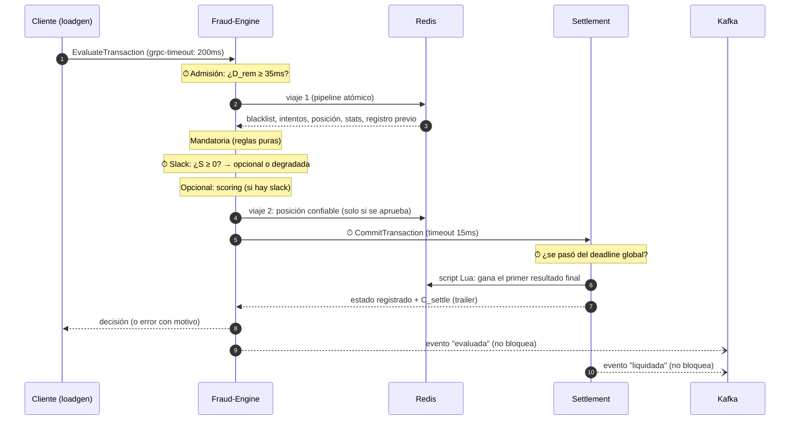

# Cómo funciona el D-RTS: el flujo completo y dónde vive el tiempo real

Este documento recorre lo que le pasa a una transacción de punta a punta,
paso por paso, y marca en cada paso **qué parte es tiempo real, en qué
módulo se evalúa y cómo**. Sirve para explicar el sistema sin leer el
código, con enlaces al código y a las decisiones (ADRs) para quien quiera
profundizar.

---

## 1. El problema en una frase

Un motor de autorización de pagos que decide **aprobar o rechazar** cada
transacción bajo un **deadline duro de 200ms de punta a punta**. A
diferencia de un sistema *best-effort*, acá **una respuesta correcta que
llega tarde cuenta como falla**, no como una respuesta lenta.

El modelo teórico que implementa todo el código: cada transacción es

$$T_i = (a_i,\ M_i,\ O_i,\ D_i), \qquad D_i = a_i + 200\text{ms}$$

- $a_i$: el instante de llegada.
- $M_i$: la **fase mandatoria**: los chequeos que no se pueden saltear.
- $O_i$: la **fase opcional**: el scoring de riesgo, que mejora la decisión
  pero se puede omitir.
- $D_i$: el deadline absoluto.

Es **Computación Imprecisa** (Liu, Lin, Shih, Yu y Zhao, 1991): siempre se
hace $M_i$, y $O_i$ solo si hay tiempo. Sin tiempo para $O_i$, la respuesta
sale "degradada" (menos precisa) **pero a tiempo**.

---

## 2. Las piezas



| Pieza | Qué hace | Camino | Código |
|---|---|---|---|
| **Load generator** | Simula a los clientes: manda transacciones con deadline de 200ms y mide lo que le llega | — (es quien mide) | [cmd/loadgen](cmd/loadgen/main.go) |
| **Fraud-Engine** | Decide: admisión, fase mandatoria, slack, fase opcional | **caliente** (dentro de los 200ms) | [cmd/server](cmd/server/main.go) |
| **Settlement** | Registra la decisión, una sola vez por transacción | **caliente** | [internal/settlement](internal/settlement/settlement.go) |
| **Redis** | Blacklist, ventana de velocidad, última posición, estadísticas, registros | **caliente** | [internal/mandatoria](internal/mandatoria/mandatoria.go) |
| **Kafka + consumidores** | Auditoría, alertas, estadísticas en vivo | **frío** (sin deadline) | [cmd/eventos](cmd/eventos/main.go) |
| **Prometheus + Grafana** | Métricas y dashboard | fuera del flujo | [observabilidad/](observabilidad/) |

**Camino caliente** (*hot path*): todo lo que pasa entre que llega la
transacción y sale la respuesta. Tiene que entrar en los 200ms.
**Camino frío** (*cold path*): lo que pasa después, sin plazo. Nunca puede
afectar la respuesta al cliente
([ADR-0019](docs/adr/0019-kafka-como-columna-de-eventos.md)).

---

## 3. El recorrido de una transacción, paso a paso

Los pasos marcados con ⏱ son los puntos donde el sistema **evalúa o hace
cumplir el tiempo real**.



### Paso 0 · El cliente emite la transacción ⏱

[cmd/loadgen](cmd/loadgen/main.go)

- Las llegadas siguen un **proceso de Poisson** (intervalos exponenciales),
  con tasa fija o siguiendo una curva del día
  ([ADR-0026](docs/adr/0026-perfil-de-carga-diario.md)).
- Es **de lazo abierto**: cada transacción sale en su propia goroutine, sin
  esperar a las anteriores. Si el sistema se pone lento, el generador **no
  afloja** (un generador que espera cada respuesta escondería la latencia
  real: *coordinated omission*,
  [ADR-0014](docs/adr/0014-load-generator-de-lazo-abierto.md)).
- Cada llamada se hace con `context.WithTimeout(200ms)`. gRPC convierte ese
  plazo en el header `grpc-timeout`, que viaja con la request.
- **La latencia se mide desde el instante programado** de la llegada, no
  desde el envío real: si el propio generador se atrasa, el atraso cuenta.

> **El loadgen no hace de persona: hace de pasarela.** Representa el borde
> del sistema, el punto donde el tráfico de muchos usuarios ya entró (como
> la pasarela de un procesador de pagos, que está en el mismo datacenter
> que el motor). Por eso corre cerca del sistema y su latencia **no incluye
> internet**: los 200ms son el presupuesto del motor de autorización, no del
> pago completo. En un pago real el límite total es de segundos (Pix, por
> ejemplo, da hasta 40s para liquidar) y se reparte por tramos; al motor de
> fraude le toca una porción chica. Las llegadas son de Poisson porque la
> suma de muchos usuarios independientes llegando al borde tiende a un
> proceso de Poisson (teorema de Palm-Khintchine). La latencia de internet
> de cada usuario es otra medida (de experiencia, no del sistema).

### Paso 1 · Llega al Fraud-Engine

[internal/metricas](internal/metricas/metricas.go) (interceptor) y
[cmd/server](cmd/server/main.go)

- gRPC reconstruye el deadline del header: el `ctx` de la request **ya trae
  el deadline del cliente** ([ADR-0002](docs/adr/0002-camino-de-decision-sincronico-con-grpc.md)).
  Todo el I/O de acá en adelante usa ese `ctx`.
- Un **interceptor** envuelve cada request: cuenta las que están en vuelo,
  mide la latencia del handler y registra el código de respuesta.

### Paso 2 · Control de admisión ⏱

[cmd/server · `admitir`](cmd/server/main.go) +
[internal/presupuesto · `Admitir`](internal/presupuesto/presupuesto.go)

$$D_{rem} = deadline(ctx) - t_{actual}$$

- Si $D_{rem} < WCET(M) + C_{settle} + C_{net} = 20 + 15 = 35\text{ms}$, se
  **rechaza sin hacer nada** (`DeadlineExceeded`, motivo `EARLY_DROP`). No
  tiene sentido empezar algo que no puede terminar a tiempo: es *load
  shedding* ([ADR-0003](docs/adr/0003-control-de-admision-temprano.md)).
- Una request **sin deadline** se rechaza (es un bug del cliente: procesarla
  "sin límite" lo taparía).
- El $D_{rem}$ de llegada se registra en un histograma: si baja de ~200ms,
  la request esperó **antes** de entrar.

### Paso 3 · Validación

[cmd/server · `validar`](cmd/server/main.go)
([ADR-0007](docs/adr/0007-validacion-estricta-de-la-request.md))

Sin `tx_id`, sin tarjeta, con coordenadas o monto inválidos, o sin
categoría → `InvalidArgument`. Es un error del cliente, no un fraude.

### Paso 4 · Viaje 1 a Redis: todo lo de la mandatoria, en una sola ida y vuelta ⏱

[internal/mandatoria · `Consultar`](internal/mandatoria/mandatoria.go)
([ADR-0008](docs/adr/0008-redis-un-viaje-atomico.md))

Un `TxPipeline` (MULTI/EXEC): todos los comandos viajan juntos y Redis los
ejecuta sin intercalar otros clientes.

| Comando | Para qué |
|---|---|
| `SISMEMBER` | ¿la tarjeta está en la blacklist? |
| `ZREMRANGEBYSCORE` + `ZADD` + `ZCARD` + `EXPIRE` | registra el intento y cuenta los de los últimos 10s (ventana deslizante) |
| `GET` | la última posición **confiable** de la tarjeta |
| `HGETALL` | las estadísticas de la categoría del comercio (para el scoring) |
| `HGETALL` | lo que Settlement ya registró para este `tx_id` (reintentos) |

Lo de tiempo real acá:
- **Un viaje y no cinco:** cada viaje de red cuesta tiempo del presupuesto.
- **El deadline llega hasta Redis:** el cliente de Redis está configurado con
  `ContextTimeoutEnabled` ([internal/redisclient](internal/redisclient/redisclient.go)).
  Sin eso, go-redis usaría su propio timeout (3s) e ignoraría los 200ms.
- **Sin reintentos** (`MaxRetries: -1`): con Redis caído se falla en
  microsegundos en vez de quemar el deadline esperando. Y es **fail-closed**:
  si no se pudo verificar, no se aprueba
  ([ADR-0009](docs/adr/0009-fail-closed-y-fallo-rapido.md)).

### Paso 5 · ¿Es un reintento de algo ya resuelto?

[cmd/server · `respuestaRegistrada`](cmd/server/main.go) +
[internal/settlement · `LeerRegistro`](internal/settlement/settlement.go)
([ADR-0027](docs/adr/0027-reintento-responde-lo-registrado.md))

Si el `tx_id` ya tiene un resultado **final** registrado (COMMITTED o
REJECTED_FRAUD), se responde eso **sin volver a evaluar**. Con la
Computación Imprecisa dos intentos de la misma transacción podrían decidir
distinto (uno degradado, otro con scoring); lo que vale es lo registrado.
De paso, el reintento no vuelve a pagar el scoring.

### Paso 6 · Fase mandatoria ($M_i$)

[internal/mandatoria · `Evaluar`](internal/mandatoria/mandatoria.go)
(funciones puras: no hacen I/O)

| Regla | Condición | Motivo del rechazo |
|---|---|---|
| Blacklist | la tarjeta está en la lista | `BLACKLIST` |
| Velocidad (*card testing*) | más de 3 intentos en 10s | `CARD_TESTING` |
| Viaje imposible | velocidad implícita desde la última posición confiable > 800 km/h (distancia de Haversine / tiempo) | `VIAJE_IMPOSIBLE` |

Presupuesto de diseño: **≤ 20ms** (casi todo es el viaje 1 a Redis). Un
fraude **no es un error**: se responde `OK` con `is_fraud = true` y el
motivo ([ADR-0005](docs/adr/0005-fraude-no-es-error.md)).

### Paso 7 · Slack: ¿hay tiempo para la fase opcional? ⏱

[cmd/server · `faseOpcional`](cmd/server/main.go) +
[internal/presupuesto · `Slack`, `CorreOpcional`](internal/presupuesto/presupuesto.go)
([ADR-0004](docs/adr/0004-computacion-imprecisa.md))

$D_{rem}$ se **vuelve a calcular acá**, con la mandatoria ya pagada:

$$S_i = D_{rem} - C_{settle} - C_{net} - WCET(O_i) = D_{rem} - 15 - 80$$

- $S_i \ge 0$ → corre el scoring.
- $S_i < 0$ → **degradada**: se responde solo con la mandatoria
  (`is_degraded = true`). Se acepta el riesgo de no haber puntuado a cambio
  de cumplir el deadline.

Con un deadline normal, $D_{rem}$ tras la mandatoria ronda los 199ms y el
slack da ~104ms: sobra tiempo. El slack se achica cuando la request llega
tarde o cuando la máquina está saturada.

### Paso 8 · Fase opcional ($O_i$): scoring de riesgo

[internal/opcional · `Puntuar`](internal/opcional/opcional.go)
([ADR-0010](docs/adr/0010-modelo-de-scoring.md))

- **Z-score sobre el logaritmo del monto**, contra la media y el desvío de
  la categoría del comercio, ponderado por el riesgo de la categoría (tasa
  de fraude real del dataset):
  $$z = \frac{\ln(monto) - \mu_{cat}}{\sigma_{cat}}, \qquad score = 1 - 0.25^{\,peso \cdot z^2 / 9}$$
- `score > 0.75` → `RIESGO_ALTO` (equivale a estar a 3 desvíos de lo normal
  con peso 1).
- Presupuesto de diseño: **≤ 80ms**. El cálculo real tarda microsegundos,
  así que se le agrega un **costo de CPU simulado** (`ITERACIONES_SCORING`,
  ~16ms sin carga) para que la fase opcional pese como pesaría un modelo
  real ([ADR-0011](docs/adr/0011-costo-simulado-y-wcet.md)).

### Paso 9 · Viaje 2 a Redis: posición confiable

[cmd/server](cmd/server/main.go)
([ADR-0006](docs/adr/0006-que-se-registra-ante-un-rechazo.md))

Solo si la transacción **se aprueba**, su ubicación pasa a ser la "última
posición confiable" de la tarjeta (la que usa el viaje imposible). Un
rechazo no mueve la tarjeta: si no, un fraude podría "teletransportarla".

### Paso 10 · Settlement registra la decisión ⏱

[cmd/server · `liquidar`](cmd/server/main.go) +
[internal/settlement](internal/settlement/settlement.go)
([ADR-0012](docs/adr/0012-settlement-segundo-servicio-sincronico.md))

Del lado del motor:
- La llamada tiene **su propio timeout de 15ms** ($C_{settle} + C_{net}$, lo
  que el slack ya le reservó). `WithTimeout` nunca alarga el deadline: si a
  la request le queda menos, gana el que vence primero.

Del lado de Settlement:
- **Chequea el deadline global otra vez:** calcula la latencia de punta a
  punta desde `emission_timestamp_ns`. Si ya pasó de 200ms, **no compromete
  nada** y registra `ABORTED_TIMEOUT`. Comprometer algo tardío sería dar por
  buena una respuesta que ya es una falla.
- **Registra una sola vez** con un script Lua atómico: si el `tx_id` ya
  tiene un resultado final, gana ese (idempotencia,
  [ADR-0013](docs/adr/0013-ambiguedad-del-timeout-e-idempotencia.md)). El
  registro vive en Redis con TTL de 24h.
- Informa su **tiempo interno** ($C_{settle}$) en un *trailer* gRPC. El motor
  calcula $C_{net} = total - C_{settle}$: así se separa el costo de la red.

### Paso 11 · La respuesta

[cmd/server · `respuestaSegunRegistro`](cmd/server/main.go)

- El motor responde **lo que quedó registrado**, no lo que evaluó este
  intento: si un intento anterior ya había comprometido, decir "fraude"
  sería mentirle al cliente.
- **Si Settlement no responde a tiempo, la respuesta es ambigua**
  (`SETTLEMENT_TIMEOUT` o `SETTLEMENT_NO_DISPONIBLE`), sea aprobación o
  rechazo: puede haberse comprometido igual. El cliente **reintenta con el
  mismo `tx_id`** y converge al resultado real
  ([ADR-0013](docs/adr/0013-ambiguedad-del-timeout-e-idempotencia.md),
  [ADR-0027](docs/adr/0027-reintento-responde-lo-registrado.md)).

### Paso 12 · Los eventos (camino frío)

[internal/eventos](internal/eventos/eventos.go)
([ADR-0024](docs/adr/0024-eventos-en-protobuf-sin-bloquear.md))

- El motor publica `TransaccionEvaluada` (lo que respondió) y Settlement
  `TransaccionLiquidada` (lo que registró), en protobuf.
- **Publicar nunca bloquea:** `TryProduce` deja el evento en un buffer y
  sigue. Si Kafka está caído o lento, el evento espera; si el buffer
  (10.000) se llena, se descarta y se cuenta. La transacción no se entera.

### Paso 13 · El cliente clasifica el resultado ⏱

[cmd/loadgen · `clasificar`](cmd/loadgen/main.go)

| Categoría | Qué pasó |
|---|---|
| `PROCESSED` | decisión a tiempo (aprobada o rechazada) |
| `EARLY_DROP` | la admisión la rechazó |
| `DEADLINE_MISS` | no hubo respuesta en 200ms |
| `AMBIGUOUS` | no se sabe si se comprometió: se reintenta con el mismo `tx_id` |
| `ERROR` | otro error con motivo |

El cliente es **la fuente de verdad del tiempo real**: el servidor no se
entera de un `DEADLINE_MISS` (para él la request "salió bien").

---

## 4. El presupuesto de los 200ms

```
0ms                                                                  200ms
├─ admisión ─┬──── M_i ≤ 20ms ────┬──────── O_i ≤ 80ms ────────┬─ settle+net 15ms ─┬── margen ──┤
│            │ viaje 1 a Redis    │ scoring (si S_i ≥ 0)       │ CommitTransaction  │            │
│  ¿D_rem ≥ 35ms?                 ¿S_i = D_rem − 95ms ≥ 0?     timeout propio 15ms  │            │
```

| Constante | Valor | Dónde | Qué es |
|---|---|---|---|
| `DeadlineGlobal` | 200ms | [presupuesto](internal/presupuesto/presupuesto.go) | $D_i - a_i$ |
| `WCETMandatoria` | 20ms | presupuesto | peor caso presupuestado de $M_i$ |
| `WCETOpcional` | 80ms | presupuesto | peor caso presupuestado de $O_i$ |
| `ReservaSettleNet` | 15ms | presupuesto | $C_{settle} + C_{net}$ |
| `MinParaAdmitir` | 35ms | presupuesto | $WCET(M) + C_{settle} + C_{net}$ |

Peor caso completo: 20 + 80 + 15 = **115ms**, dentro de los 200ms (lo
verifica un test, `TestCoherenciaDelDiseno`).

> **Son puntos de partida de diseño, no mediciones.** Se recalibran
> midiendo en cada entorno (Etapa 10 del roadmap,
> [ADR-0018](docs/adr/0018-evaluar-en-distintos-entornos.md)).

---

## 5. Dónde se evalúa el tiempo real (resumen)

| # | Mecanismo | Módulo | Qué decide o mide | Si no alcanza el tiempo |
|---|---|---|---|---|
| 1 | **Deadline del cliente** | `cmd/loadgen` | 200ms por transacción, medidos desde el instante programado | `DEADLINE_MISS` |
| 2 | **Propagación del deadline** | gRPC (`grpc-timeout`), `internal/redisclient` (`ContextTimeoutEnabled`), `cmd/server` (`ctx` a Settlement) | el mismo plazo llega a Redis y a Settlement | cada I/O corta cuando vence |
| 3 | **Admisión** | `internal/presupuesto.Admitir`, `cmd/server.admitir` | ¿$D_{rem} \ge 35ms$? | `EARLY_DROP`, sin trabajar |
| 4 | **Fallo rápido** | `internal/redisclient` (sin reintentos) | no quemar el plazo esperando a un Redis caído | error en µs, fail-closed |
| 5 | **Slack (Computación Imprecisa)** | `internal/presupuesto.Slack`, `cmd/server.faseOpcional` | ¿$S_i \ge 0$? | respuesta **degradada** (solo mandatoria) |
| 6 | **Reserva para Settlement** | `cmd/server.liquidar` (`WithTimeout` 15ms) | Settlement no puede llevarse el plazo entero | `SETTLEMENT_TIMEOUT` (ambiguo) |
| 7 | **Deadline global en Settlement** | `internal/settlement` | ¿la transacción ya superó los 200ms? | `ABORTED_TIMEOUT`: no se compromete |
| 8 | **Detección de respuestas tardías** | `internal/metricas` (interceptor: `ctx.Err()` al terminar) | el servidor terminó para un cliente que ya se fue | métrica `drts_respuestas_tardias_total` |
| 9 | **Medición** | `internal/metricas`, `cmd/loadgen` | D_rem al llegar, slack, duración de cada fase, $C_{net}$, latencia del cliente | — |
| 10 | **Auditoría** (después, sin plazo) | `internal/auditoria`, `cmd/eventos` | ¿lo respondido coincide con lo registrado? | marca las discrepancias |

Lo que **no** es tiempo real, a propósito: el camino frío (Kafka y sus
consumidores). No tiene deadline y no puede frenar una respuesta.

---

## 6. Qué pasa cuando algo falla

| Situación | Qué responde el sistema | Por qué |
|---|---|---|
| Llega sin tiempo suficiente | `EARLY_DROP` en ~1ms | no empezar lo que no puede terminar |
| No hay slack para el scoring | aprobada o rechazada **degradada** | a tiempo, con menos precisión |
| Redis caído o lento | error (`REDIS_NO_DISPONIBLE` / `REDIS_TIMEOUT`) | **fail-closed**: sin verificar no se aprueba |
| Settlement no responde a tiempo | error **ambiguo**; el cliente reintenta | puede haberse comprometido igual |
| La transacción llega a Settlement tarde | `ABORTED_TIMEOUT`, nada comprometido | lo tardío ya es falla |
| Reintento de algo ya registrado | lo registrado, sin re-evaluar | una sola verdad por `tx_id` |
| Kafka caído | **nada cambia** en la respuesta; los eventos esperan en el buffer | el camino frío no afecta al caliente |
| Un consumidor caído | nada cambia; el lag crece y se pone al día al volver | ídem |

Tres reglas atraviesan todo:
1. **Fail-closed:** ante la duda, no aprobar.
2. **Idempotencia por `tx_id`:** reintentar no cambia el resultado.
3. **El motor obedece al registro:** se responde lo registrado, no lo
   evaluado en este intento.

---

## 7. El camino frío: auditoría, alertas y estadísticas

[cmd/eventos](cmd/eventos/main.go),
[internal/auditoria](internal/auditoria/auditoria.go)
([ADR-0025](docs/adr/0025-consumidores-y-auditoria.md))

Tres consumidores leen los eventos de Kafka, cada uno a su ritmo:

- **Auditoría:** cruza, por `tx_id`, lo que respondió el motor con lo que
  registró Settlement (espera hasta 30s la pareja) y lo guarda en
  `auditoria/AAAA-MM-DD.jsonl`.

  | Resultado | Significa |
  |---|---|
  | CONSISTENTE | respuesta = registro |
  | NO_COMPROMETIDA | error y nada registrado (coherente) |
  | AMBIGUA_COMPROMETIDA | el cliente vio error, pero se comprometió |
  | REGISTRO_PERDIDO | decisión sin registro |
  | EVENTO_PERDIDO | falta el evento de un lado |
  | INCONSISTENTE | la respuesta contradice el registro: **un bug** |

  Fue la auditoría la que encontró, bajo carga, el bug que corrigió el
  ADR-0027.
- **Alertas:** un aviso por cada fraude detectado.
- **Estadísticas en sombra:** recalcula en vivo la media y el desvío por
  categoría (algoritmo de Welford) y mide cuánto se alejan de la línea
  base. El motor **no** las usa todavía: se observan antes de confiar en
  ellas.

---

## 8. Observabilidad

Prometheus scrapea cada 1s a todos los servicios, y Grafana muestra el
dashboard "D-RTS — Tiempo real", provisionado desde archivos
([ADR-0015](docs/adr/0015-observabilidad-prometheus-grafana.md)). Se lee de
arriba hacia abajo: lo que ve el cliente → por qué (el motor por dentro) →
Settlement → CPU y runtime → camino frío. Qué muestra cada panel y cómo
diagnosticar con él: [observabilidad/GUIA-DASHBOARD.md](observabilidad/GUIA-DASHBOARD.md).

---

## 9. Cómo se evalúa: métricas oficiales y objetivos

El dashboard sirve para diagnosticar; lo que se **reporta** son las métricas
del contrato de tiempo real, definidas en
[ADR-0028](docs/adr/0028-metricas-de-evaluacion-sli-slo-sla.md):

| Métrica oficial | Objetivo (SLO) |
|---|---|
| Decisiones a tiempo (1 − Deadline Miss Ratio) | ≥ 99% |
| Latencia ≤ 100ms | ≥ 99% |
| Decisiones con scoring (no degradadas) | ≥ 99% |
| Correctitud (sin INCONSISTENTE) | 100% |
| Sin ambiguas comprometidas | ≥ 99,9% |

- Se miden **en el borde** (el loadgen; en AWS también el balanceador), con
  el CSV de cada transacción como fuente, no con los buckets de Prometheus.
- Valen **dentro de una envolvente de carga** (inicial: 400 RPS en la
  notebook de desarrollo). El SLO es el mismo en todos los entornos; lo que
  se compara es **hasta qué carga se cumple** (la capacidad bajo SLO).
- La garantía de cada transacción es dura (tarde = falla), pero la del
  sistema es **estadística**: en la nube no se puede probar un WCET, solo
  medir el DMR contra un objetivo (*firm real-time*).
- Un SLA ilustrativo, más laxo (98%), muestra la diferencia entre lo que se
  apunta y lo que se promete.

## 10. Lo que medimos (hasta ahora)

Docker Compose en la notebook de desarrollo (i7-12650H, 16 hilos, con el
cargador conectado y el perfil de energía en `performance`). **Son valores
de esta máquina:** en otro entorno cambian, y compararlos es justamente el
objetivo de la evaluación.

| Qué | Valor |
|---|---|
| Latencia del cliente con carga nominal (50 RPS) | P50 ~20ms, 100% a tiempo |
| Costo de red entre motor y Settlement ($C_{net}$) | P50 ~0,3ms (contra 15ms reservados) |
| CPU por transacción en el motor | ~21ms (casi todo, el scoring simulado) |
| Quiebre (donde el % a tiempo baja de 99%) | ~500 RPS; se recupera al bajar de ~470 |
| Un día de carga (pico 800 RPS, ×60), antes del ADR-0027 | 85% a tiempo en el día; ~65% en el pico de las 19h |
| Ventana del mediodía (11 a 14h, pico 800), antes y después del ADR-0027 | ~75% → ~97% a tiempo; INCONSISTENTE 20 → 0 |

---

## 11. Limitaciones conocidas

- **Colapso por congestión.** El motor no tiene cola: cada request es una
  goroutine y todas comparten el CPU. Pasado el quiebre, **todas** se
  vuelven lentas y vencen juntas, en vez de rechazar rápido las que sobran.
  La admisión casi no actúa, porque la mayoría llega con ~200ms y el tiempo
  se pierde *adentro*. Se ataca en la Etapa 10 (control por concurrencia o
  pool de workers, y recalibración).
- **Tormenta de reintentos.** Bajo saturación, los reintentos de las
  ambiguas suman carga. El ADR-0027 la atenuó mucho (los reintentos ya no
  pagan el scoring); falta backoff en el cliente.
- **Motivos engañosos bajo saturación.** Aparecen `REDIS_NO_DISPONIBLE` y
  `SETTLEMENT_NO_DISPONIBLE` con los dos servicios sanos. La decisión es
  correcta (fail-closed), pero el motivo confunde. Pendiente.
- **La latencia de punta a punta que mide Settlement compara relojes** de
  dos procesos. Entre hosts depende de que estén sincronizados; por eso la
  latencia de referencia es la del cliente.

---

## Glosario

| Término | Qué es |
|---|---|
| **Deadline duro** | plazo que, si se pasa, la respuesta cuenta como falla |
| **$D_{rem}$** | tiempo que le queda a la transacción: deadline − ahora |
| **WCET** | *Worst-Case Execution Time*: el peor tiempo de ejecución presupuestado |
| **Slack** | cuánto sobraría si se corre la fase opcional en su peor caso |
| **Degradada** | respondida solo con la fase mandatoria, por falta de tiempo |
| **Admisión / load shedding** | rechazar al llegar lo que no puede terminar a tiempo |
| **Fail-closed** | ante la duda (no se pudo verificar), no aprobar |
| **Idempotencia** | repetir la operación no cambia el resultado |
| **Ambigua** | respuesta de la que no se sabe si quedó comprometida |
| **Camino caliente / frío** | dentro de los 200ms / después, sin plazo |
| **Goodput** | transacciones resueltas a tiempo por segundo |
| **Lazo abierto** | el generador no espera respuestas para mandar la siguiente |
