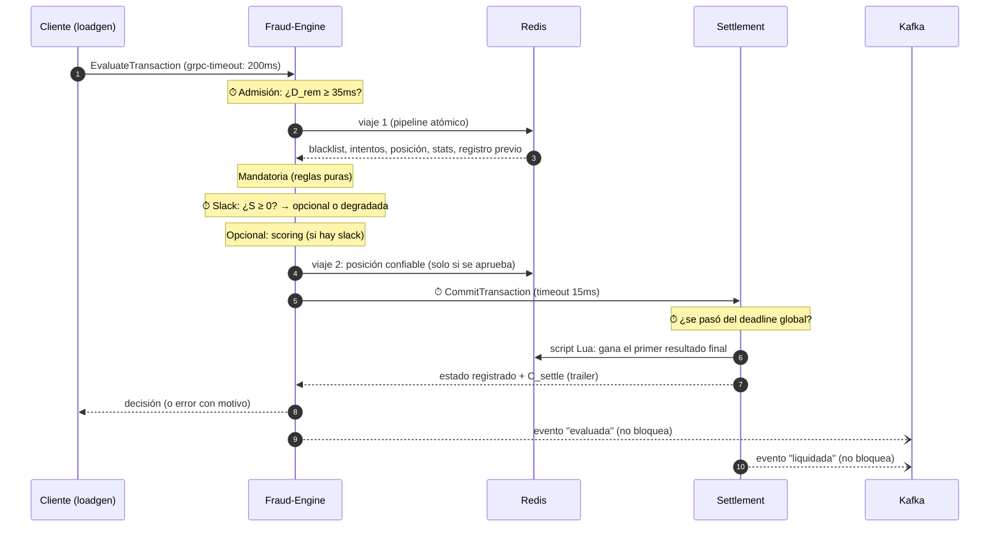

# Cómo funciona el D-RTS: el flujo completo y dónde vive el tiempo real

Este documento recorre lo que le pasa a una transacción de punta a punta,
paso por paso, y marca en cada paso **qué parte es tiempo real, en qué
módulo se evalúa y cómo**. Sirve para explicar el sistema sin leer el
código, con enlaces al código y a las decisiones (ADRs) para quien quiera
profundizar.

---

## 1. El problema en una frase

Un motor de autorización de pagos que decide **aprobar o rechazar** cada
transacción bajo un **deadline duro de 200ms de punta a punta**. A
diferencia de un sistema *best-effort*, acá **una respuesta correcta que
llega tarde cuenta como falla**, no como una respuesta lenta.

El modelo teórico que implementa todo el código: cada transacción es

$$T_i = (a_i,\ M_i,\ O_i,\ D_i), \qquad D_i = a_i + 200\text{ms}$$

- $a_i$: el instante de llegada.
- $M_i$: la **fase mandatoria**: los chequeos que no se pueden saltear.
- $O_i$: la **fase opcional**: el scoring de riesgo, que mejora la decisión
  pero se puede omitir.
- $D_i$: el deadline absoluto.

Es **Computación Imprecisa** (Liu, Lin, Shih, Yu y Zhao, 1991): siempre se
hace $M_i$, y $O_i$ solo si hay tiempo. Sin tiempo para $O_i$, la respuesta
sale "degradada" (menos precisa) **pero a tiempo**.

---

## 2. Las piezas


| Pieza | Qué hace | Camino | Código |
|---|---|---|---|
| **Load generator** | Simula a los clientes: manda transacciones con deadline de 200ms y mide lo que le llega | — (es quien mide) | [cmd/loadgen](cmd/loadgen/main.go) |
| **Fraud-Engine** | Decide: admisión, fase mandatoria, slack, fase opcional | **caliente** (dentro de los 200ms) | [cmd/server](cmd/server/main.go) |
| **Settlement** | Registra la decisión, una sola vez por transacción | **caliente** | [internal/settlement](internal/settlement/settlement.go) |
| **Redis** | Blacklist, ventana de velocidad, última posición, estadísticas, registros | **caliente** | [internal/mandatoria](internal/mandatoria/mandatoria.go) |
| **Kafka + consumidores** | Auditoría, alertas, estadísticas en vivo | **frío** (sin deadline) | [cmd/eventos](cmd/eventos/main.go) |
| **Prometheus + Grafana** | Métricas y dashboard | fuera del flujo | [observabilidad/](observabilidad/) |

Por qué se eligió cada herramienta (gRPC y no REST, Redis, Kafka, etc.):
[sección 12](#12-por-qué-cada-herramienta).

**Camino caliente** (*hot path*): todo lo que pasa entre que llega la
transacción y sale la respuesta. Tiene que entrar en los 200ms.
**Camino frío** (*cold path*): lo que pasa después, sin plazo. Nunca puede
afectar la respuesta al cliente
([ADR-0019](docs/adr/0019-kafka-como-columna-de-eventos.md)).

---

## 3. El recorrido de una transacción, paso a paso

Los pasos marcados con ⏱ son los puntos donde el sistema **evalúa o hace
cumplir el tiempo real**.



### Paso 0 · El cliente emite la transacción ⏱

[cmd/loadgen](cmd/loadgen/main.go)

- Las llegadas siguen un **proceso de Poisson** (intervalos exponenciales),
  con tasa fija o siguiendo una curva del día
  ([ADR-0026](docs/adr/0026-perfil-de-carga-diario.md)).
- Es **de lazo abierto**: cada transacción sale en su propia goroutine, sin
  esperar a las anteriores. Si el sistema se pone lento, el generador **no
  afloja** (un generador que espera cada respuesta escondería la latencia
  real: *coordinated omission*,
  [ADR-0014](docs/adr/0014-load-generator-de-lazo-abierto.md)).
- Cada llamada se hace con `context.WithTimeout(200ms)`. gRPC convierte ese
  plazo en el header `grpc-timeout`, que viaja con la request.
- **La latencia se mide desde el instante programado** de la llegada, no
  desde el envío real: si el propio generador se atrasa, el atraso cuenta.

> **El loadgen no hace de persona: hace de pasarela.** Representa el borde
> del sistema, el punto donde el tráfico de muchos usuarios ya entró (como
> la pasarela de un procesador de pagos, que está en el mismo datacenter
> que el motor). Por eso corre cerca del sistema y su latencia **no incluye
> internet**: los 200ms son el presupuesto del motor de autorización, no del
> pago completo. En un pago real el límite total es de segundos (Pix, por
> ejemplo, da hasta 40s para liquidar) y se reparte por tramos; al motor de
> fraude le toca una porción chica. Las llegadas son de Poisson porque la
> suma de muchos usuarios independientes llegando al borde tiende a un
> proceso de Poisson (teorema de Palm-Khintchine). La latencia de internet
> de cada usuario es otra medida (de experiencia, no del sistema).

### Paso 1 · Llega al Fraud-Engine

[internal/metricas](internal/metricas/metricas.go) (interceptor) y
[cmd/server](cmd/server/main.go)

- gRPC reconstruye el deadline del header: el `ctx` de la request **ya trae
  el deadline del cliente** ([ADR-0002](docs/adr/0002-camino-de-decision-sincronico-con-grpc.md)).
  Todo el I/O de acá en adelante usa ese `ctx`.
- Un **interceptor** envuelve cada request: cuenta las que están en vuelo,
  mide la latencia del handler y registra el código de respuesta.

### Paso 2 · Control de admisión ⏱

[cmd/server · `admitir`](cmd/server/main.go) +
[internal/presupuesto · `Admitir`](internal/presupuesto/presupuesto.go)

$$D_{rem} = deadline(ctx) - t_{actual}$$

- Si $D_{rem} < WCET(M) + C_{settle} + C_{net} = 20 + 15 = 35\text{ms}$, se
  **rechaza sin hacer nada** (`DeadlineExceeded`, motivo `EARLY_DROP`). No
  tiene sentido empezar algo que no puede terminar a tiempo: es *load
  shedding* ([ADR-0003](docs/adr/0003-control-de-admision-temprano.md)).
- Una request **sin deadline** se rechaza (es un bug del cliente: procesarla
  "sin límite" lo taparía).
- El $D_{rem}$ de llegada se registra en un histograma: si baja de ~200ms,
  la request esperó **antes** de entrar.

### Paso 3 · Validación

[cmd/server · `validar`](cmd/server/main.go)
([ADR-0007](docs/adr/0007-validacion-estricta-de-la-request.md))

Sin `tx_id`, sin tarjeta, con coordenadas o monto inválidos, o sin
categoría → `InvalidArgument`. Es un error del cliente, no un fraude.

### Paso 4 · Viaje 1 a Redis: todo lo de la mandatoria, en una sola ida y vuelta ⏱

[internal/mandatoria · `Consultar`](internal/mandatoria/mandatoria.go)
([ADR-0008](docs/adr/0008-redis-un-viaje-atomico.md))

Un `TxPipeline` (MULTI/EXEC): todos los comandos viajan juntos y Redis los
ejecuta sin intercalar otros clientes.

| Comando | Para qué |
|---|---|
| `SISMEMBER` | ¿la tarjeta está en la blacklist? |
| `ZREMRANGEBYSCORE` + `ZADD` + `ZCARD` + `EXPIRE` | registra el intento y cuenta los de los últimos 10s (ventana deslizante) |
| `GET` | la última posición **confiable** de la tarjeta |
| `HGETALL` | las estadísticas de la categoría del comercio (para el scoring) |
| `HGETALL` | lo que Settlement ya registró para este `tx_id` (reintentos) |

Lo de tiempo real acá:
- **Un viaje y no cinco:** cada viaje de red cuesta tiempo del presupuesto.
- **El deadline llega hasta Redis:** el cliente de Redis está configurado con
  `ContextTimeoutEnabled` ([internal/redisclient](internal/redisclient/redisclient.go)).
  Sin eso, go-redis usaría su propio timeout (3s) e ignoraría los 200ms.
- **Sin reintentos** (`MaxRetries: -1`): con Redis caído se falla en
  microsegundos en vez de quemar el deadline esperando. Y es **fail-closed**:
  si no se pudo verificar, no se aprueba
  ([ADR-0009](docs/adr/0009-fail-closed-y-fallo-rapido.md)).

### Paso 5 · ¿Es un reintento de algo ya resuelto?

[cmd/server · `respuestaRegistrada`](cmd/server/main.go) +
[internal/settlement · `LeerRegistro`](internal/settlement/settlement.go)
([ADR-0027](docs/adr/0027-reintento-responde-lo-registrado.md))

Si el `tx_id` ya tiene un resultado **final** registrado (COMMITTED o
REJECTED_FRAUD), se responde eso **sin volver a evaluar**. Con la
Computación Imprecisa dos intentos de la misma transacción podrían decidir
distinto (uno degradado, otro con scoring); lo que vale es lo registrado.
De paso, el reintento no vuelve a pagar el scoring.

### Paso 6 · Fase mandatoria ($M_i$)

[internal/mandatoria · `Evaluar`](internal/mandatoria/mandatoria.go)
(funciones puras: no hacen I/O)

| Regla | Condición | Motivo del rechazo |
|---|---|---|
| Blacklist | la tarjeta está en la lista | `BLACKLIST` |
| Velocidad (*card testing*) | más de 3 intentos en 10s | `CARD_TESTING` |
| Viaje imposible | velocidad implícita desde la última posición confiable > 800 km/h (distancia de Haversine / tiempo) | `VIAJE_IMPOSIBLE` |

Presupuesto de diseño: **≤ 20ms** (casi todo es el viaje 1 a Redis). Un
fraude **no es un error**: se responde `OK` con `is_fraud = true` y el
motivo ([ADR-0005](docs/adr/0005-fraude-no-es-error.md)).

### Paso 7 · Slack: ¿hay tiempo para la fase opcional? ⏱

[cmd/server · `faseOpcional`](cmd/server/main.go) +
[internal/presupuesto · `Slack`, `CorreOpcional`](internal/presupuesto/presupuesto.go)
([ADR-0004](docs/adr/0004-computacion-imprecisa.md))

$D_{rem}$ se **vuelve a calcular acá**, con la mandatoria ya pagada:

$$S_i = D_{rem} - C_{settle} - C_{net} - WCET(O_i) = D_{rem} - 15 - 80$$

- $S_i \ge 0$ → corre el scoring.
- $S_i < 0$ → **degradada**: se responde solo con la mandatoria
  (`is_degraded = true`). Se acepta el riesgo de no haber puntuado a cambio
  de cumplir el deadline.

Con un deadline normal, $D_{rem}$ tras la mandatoria ronda los 199ms y el
slack da ~104ms: sobra tiempo. El slack se achica cuando la request llega
tarde o cuando la máquina está saturada.

### Paso 8 · Fase opcional ($O_i$): scoring de riesgo

[internal/opcional · `Puntuar`](internal/opcional/opcional.go)
([ADR-0010](docs/adr/0010-modelo-de-scoring.md))

- **Z-score sobre el logaritmo del monto**, contra la media y el desvío de
  la categoría del comercio, ponderado por el riesgo de la categoría (tasa
  de fraude real del dataset):
  $$z = \frac{\ln(monto) - \mu_{cat}}{\sigma_{cat}}, \qquad score = 1 - 0.25^{\,peso \cdot z^2 / 9}$$
- `score > 0.75` → `RIESGO_ALTO` (equivale a estar a 3 desvíos de lo normal
  con peso 1).
- Presupuesto de diseño: **≤ 80ms**. El cálculo real tarda microsegundos,
  así que se le agrega un **costo de CPU simulado** (`ITERACIONES_SCORING`,
  ~16ms sin carga) para que la fase opcional pese como pesaría un modelo
  real ([ADR-0011](docs/adr/0011-costo-simulado-y-wcet.md)).

### Paso 9 · Viaje 2 a Redis: posición confiable

[cmd/server](cmd/server/main.go)
([ADR-0006](docs/adr/0006-que-se-registra-ante-un-rechazo.md))

Solo si la transacción **se aprueba**, su ubicación pasa a ser la "última
posición confiable" de la tarjeta (la que usa el viaje imposible). Un
rechazo no mueve la tarjeta: si no, un fraude podría "teletransportarla".

### Paso 10 · Settlement registra la decisión ⏱

[cmd/server · `liquidar`](cmd/server/main.go) +
[internal/settlement](internal/settlement/settlement.go)
([ADR-0012](docs/adr/0012-settlement-segundo-servicio-sincronico.md))

Del lado del motor:
- La llamada tiene **su propio timeout de 15ms** ($C_{settle} + C_{net}$, lo
  que el slack ya le reservó). `WithTimeout` nunca alarga el deadline: si a
  la request le queda menos, gana el que vence primero.

Del lado de Settlement:
- **Chequea el deadline global otra vez:** calcula la latencia de punta a
  punta desde `emission_timestamp_ns`. Si ya pasó de 200ms, **no compromete
  nada** y registra `ABORTED_TIMEOUT`. Comprometer algo tardío sería dar por
  buena una respuesta que ya es una falla.
- **Registra una sola vez** con un script Lua atómico: si el `tx_id` ya
  tiene un resultado final, gana ese (idempotencia,
  [ADR-0013](docs/adr/0013-ambiguedad-del-timeout-e-idempotencia.md)). El
  registro vive en Redis con TTL de 24h.
- Informa su **tiempo interno** ($C_{settle}$) en un *trailer* gRPC. El motor
  calcula $C_{net} = total - C_{settle}$: así se separa el costo de la red.

### Paso 11 · La respuesta

[cmd/server · `respuestaSegunRegistro`](cmd/server/main.go)

- El motor responde **lo que quedó registrado**, no lo que evaluó este
  intento: si un intento anterior ya había comprometido, decir "fraude"
  sería mentirle al cliente.
- **Si Settlement no responde a tiempo, la respuesta es ambigua**
  (`SETTLEMENT_TIMEOUT` o `SETTLEMENT_NO_DISPONIBLE`), sea aprobación o
  rechazo: puede haberse comprometido igual. El cliente **reintenta con el
  mismo `tx_id`** y converge al resultado real
  ([ADR-0013](docs/adr/0013-ambiguedad-del-timeout-e-idempotencia.md),
  [ADR-0027](docs/adr/0027-reintento-responde-lo-registrado.md)).

### Paso 12 · Los eventos (camino frío)

[internal/eventos](internal/eventos/eventos.go)
([ADR-0024](docs/adr/0024-eventos-en-protobuf-sin-bloquear.md))

- El motor publica `TransaccionEvaluada` (lo que respondió) y Settlement
  `TransaccionLiquidada` (lo que registró), en protobuf.
- **Publicar nunca bloquea:** `TryProduce` deja el evento en un buffer y
  sigue. Si Kafka está caído o lento, el evento espera; si el buffer
  (10.000) se llena, se descarta y se cuenta. La transacción no se entera.

### Paso 13 · El cliente clasifica el resultado ⏱

[cmd/loadgen · `clasificar`](cmd/loadgen/main.go)

| Categoría | Qué pasó |
|---|---|
| `PROCESSED` | decisión a tiempo (aprobada o rechazada) |
| `EARLY_DROP` | la admisión la rechazó |
| `DEADLINE_MISS` | no hubo respuesta en 200ms |
| `AMBIGUOUS` | no se sabe si se comprometió: se reintenta con el mismo `tx_id` |
| `ERROR` | otro error con motivo |

El cliente es **la fuente de verdad del tiempo real**: el servidor no se
entera de un `DEADLINE_MISS` (para él la request "salió bien").

---

## 4. El presupuesto de los 200ms

```
0ms                                                                  200ms
├─ admisión ─┬──── M_i ≤ 20ms ────┬──────── O_i ≤ 80ms ────────┬─ settle+net 15ms ─┬── margen ──┤
│            │ viaje 1 a Redis    │ scoring (si S_i ≥ 0)       │ CommitTransaction  │            │
│  ¿D_rem ≥ 35ms?                 ¿S_i = D_rem − 95ms ≥ 0?     timeout propio 15ms  │            │
```

| Constante | Valor | Dónde | Qué es |
|---|---|---|---|
| `DeadlineGlobal` | 200ms | [presupuesto](internal/presupuesto/presupuesto.go) | $D_i - a_i$ |
| `WCETMandatoria` | 20ms | presupuesto | peor caso presupuestado de $M_i$ |
| `WCETOpcional` | 80ms | presupuesto | peor caso presupuestado de $O_i$ |
| `ReservaSettleNet` | 15ms | presupuesto | $C_{settle} + C_{net}$ |
| `MinParaAdmitir` | 35ms | presupuesto | $WCET(M) + C_{settle} + C_{net}$ |

Peor caso completo: 20 + 80 + 15 = **115ms**, dentro de los 200ms (lo
verifica un test, `TestCoherenciaDelDiseno`).

> **Son puntos de partida de diseño, no mediciones.** Se recalibran
> midiendo en cada entorno (Etapa 10 del roadmap,
> [ADR-0018](docs/adr/0018-evaluar-en-distintos-entornos.md)).

---

## 5. Dónde se evalúa el tiempo real (resumen)

Cada fila enlaza al **código exacto** (archivo y líneas) y a su
**explicación con el fragmento de código** en el
[anexo](#anexo-el-código-del-tiempo-real).

| # | Mecanismo | Qué decide o mide | Si no alcanza el tiempo | Código |
|---|---|---|---|---|
| 1 | **Deadline del cliente** | 200ms por transacción, medidos desde el instante programado | `DEADLINE_MISS` | [loadgen `enviar`](cmd/loadgen/main.go#L222-L240) · [explicación](#m1) |
| 2 | **Propagación del deadline** | el mismo plazo llega al motor, a Redis y a Settlement | cada I/O corta cuando vence | [motor `admitir`](cmd/server/main.go#L184-L189) · [Redis](internal/redisclient/redisclient.go#L20-L25) · [explicación](#m2) |
| 3 | **Admisión** | ¿$D_{rem} \ge 35ms$? | `EARLY_DROP`, sin trabajar | [`Admitir`](internal/presupuesto/presupuesto.go#L42-L44) · [motor](cmd/server/main.go#L184-L198) · [explicación](#m3) |
| 4 | **Fallo rápido** | no quemar el plazo esperando a un Redis caído | error en µs, fail-closed | [`redisclient`](internal/redisclient/redisclient.go#L26-L35) · [explicación](#m4) |
| 5 | **Slack (Computación Imprecisa)** | ¿$S_i \ge 0$? | respuesta **degradada** | [`Slack`](internal/presupuesto/presupuesto.go#L52-L60) · [motor](cmd/server/main.go#L258-L273) · [explicación](#m5) |
| 6 | **Reserva para Settlement** | Settlement no puede llevarse el plazo entero | `SETTLEMENT_TIMEOUT` (ambiguo) | [`liquidar`](cmd/server/main.go#L306-L330) · [explicación](#m6) |
| 7 | **Deadline global en Settlement** | ¿la transacción ya superó los 200ms? | `ABORTED_TIMEOUT`: no se compromete | [Settlement](internal/settlement/settlement.go#L146-L158) · [explicación](#m7) |
| 8 | **Respuestas tardías** | el servidor terminó para un cliente que ya se fue | métrica `drts_respuestas_tardias_total` | [interceptor](internal/metricas/metricas.go#L127-L143) · [explicación](#m8) |
| 9 | **Medición del presupuesto** | $D_{rem}$ al llegar, slack, cada fase, $C_{net}$ | — | [`medirSettlement`](cmd/server/main.go#L401-L407) · [explicación](#m9) |
| 10 | **El presupuesto cierra** | peor caso ≤ 200ms, verificado por un test | el test falla | [`TestCoherenciaDelDiseno`](internal/presupuesto/presupuesto_test.go#L63-L73) · [explicación](#m10) |
| 11 | **Auditoría** (después, sin plazo) | ¿lo respondido coincide con lo registrado? | marca las discrepancias | [`Clasificar`](internal/auditoria/auditoria.go#L50-L82) · [explicación](#m11) |

Lo que **no** es tiempo real, a propósito: el camino frío (Kafka y sus
consumidores). No tiene deadline y no puede frenar una respuesta.

## 6. Qué pasa cuando algo falla

| Situación | Qué responde el sistema | Por qué |
|---|---|---|
| Llega sin tiempo suficiente | `EARLY_DROP` en ~1ms | no empezar lo que no puede terminar |
| No hay slack para el scoring | aprobada o rechazada **degradada** | a tiempo, con menos precisión |
| Redis caído o lento | error (`REDIS_NO_DISPONIBLE` / `REDIS_TIMEOUT`) | **fail-closed**: sin verificar no se aprueba |
| Settlement no responde a tiempo | error **ambiguo**; el cliente reintenta | puede haberse comprometido igual |
| La transacción llega a Settlement tarde | `ABORTED_TIMEOUT`, nada comprometido | lo tardío ya es falla |
| Reintento de algo ya registrado | lo registrado, sin re-evaluar | una sola verdad por `tx_id` |
| Kafka caído | **nada cambia** en la respuesta; los eventos esperan en el buffer | el camino frío no afecta al caliente |
| Un consumidor caído | nada cambia; el lag crece y se pone al día al volver | ídem |

Tres reglas atraviesan todo:
1. **Fail-closed:** ante la duda, no aprobar.
2. **Idempotencia por `tx_id`:** reintentar no cambia el resultado.
3. **El motor obedece al registro:** se responde lo registrado, no lo
   evaluado en este intento.

---

## 7. El camino frío: auditoría, alertas y estadísticas

[cmd/eventos](cmd/eventos/main.go),
[internal/auditoria](internal/auditoria/auditoria.go)
([ADR-0025](docs/adr/0025-consumidores-y-auditoria.md))

Tres consumidores leen los eventos de Kafka, cada uno a su ritmo:

- **Auditoría:** cruza, por `tx_id`, lo que respondió el motor con lo que
  registró Settlement (espera hasta 30s la pareja) y lo guarda en
  `auditoria/AAAA-MM-DD.jsonl`.

  | Resultado | Significa |
  |---|---|
  | CONSISTENTE | respuesta = registro |
  | NO_COMPROMETIDA | error y nada registrado (coherente) |
  | AMBIGUA_COMPROMETIDA | el cliente vio error, pero se comprometió |
  | REGISTRO_PERDIDO | decisión sin registro |
  | EVENTO_PERDIDO | falta el evento de un lado |
  | INCONSISTENTE | la respuesta contradice el registro: **un bug** |

  Fue la auditoría la que encontró, bajo carga, el bug que corrigió el
  ADR-0027.
- **Alertas:** un aviso por cada fraude detectado.
- **Estadísticas en sombra:** recalcula en vivo la media y el desvío por
  categoría (algoritmo de Welford) y mide cuánto se alejan de la línea
  base. El motor **no** las usa todavía: se observan antes de confiar en
  ellas.

---

## 8. Observabilidad

Prometheus scrapea cada 1s a todos los servicios, y Grafana muestra el
dashboard "D-RTS — Tiempo real", provisionado desde archivos
([ADR-0015](docs/adr/0015-observabilidad-prometheus-grafana.md)). Se lee de
arriba hacia abajo: lo que ve el cliente → por qué (el motor por dentro) →
Settlement → CPU y runtime → camino frío. Qué muestra cada panel y cómo
diagnosticar con él: [observabilidad/GUIA-DASHBOARD.md](observabilidad/GUIA-DASHBOARD.md).

---

## 9. Cómo se evalúa: métricas oficiales y objetivos

El dashboard sirve para diagnosticar; lo que se **reporta** son las métricas
del contrato de tiempo real, definidas en
[ADR-0028](docs/adr/0028-metricas-de-evaluacion-sli-slo-sla.md):

| Métrica oficial | Objetivo (SLO) |
|---|---|
| Decisiones a tiempo (1 − Deadline Miss Ratio) | ≥ 99% |
| Latencia ≤ 100ms | ≥ 99% |
| Decisiones con scoring (no degradadas) | ≥ 99% |
| Correctitud (sin INCONSISTENTE) | 100% |
| Sin ambiguas comprometidas | ≥ 99,9% |

- Se miden **en el borde** (el loadgen; en AWS también el balanceador), con
  el CSV de cada transacción como fuente, no con los buckets de Prometheus.
- Valen **dentro de una envolvente de carga** (inicial: 400 RPS en la
  notebook de desarrollo). El SLO es el mismo en todos los entornos; lo que
  se compara es **hasta qué carga se cumple** (la capacidad bajo SLO).
- La garantía de cada transacción es dura (tarde = falla), pero la del
  sistema es **estadística**: en la nube no se puede probar un WCET, solo
  medir el DMR contra un objetivo (*firm real-time*).
- Un SLA ilustrativo, más laxo (98%), muestra la diferencia entre lo que se
  apunta y lo que se promete.

## 10. Lo que medimos (hasta ahora)

Docker Compose en la notebook de desarrollo (i7-12650H, 16 hilos, con el
cargador conectado y el perfil de energía en `performance`). **Son valores
de esta máquina:** en otro entorno cambian, y compararlos es justamente el
objetivo de la evaluación.

| Qué | Valor |
|---|---|
| Latencia del cliente con carga nominal (50 RPS) | P50 ~20ms, 100% a tiempo |
| Costo de red entre motor y Settlement ($C_{net}$) | P50 ~0,3ms (contra 15ms reservados) |
| CPU por transacción en el motor | ~21ms (casi todo, el scoring simulado) |
| Quiebre (donde el % a tiempo baja de 99%) | ~500 RPS; se recupera al bajar de ~470 |
| Un día de carga (pico 800 RPS, ×60), antes del ADR-0027 | 85% a tiempo en el día; ~65% en el pico de las 19h |
| Ventana del mediodía (11 a 14h, pico 800), antes y después del ADR-0027 | ~75% → ~97% a tiempo; INCONSISTENTE 20 → 0 |

---

## 11. Limitaciones conocidas

- **Colapso por congestión.** El motor no tiene cola: cada request es una
  goroutine y todas comparten el CPU. Pasado el quiebre, **todas** se
  vuelven lentas y vencen juntas, en vez de rechazar rápido las que sobran.
  La admisión casi no actúa, porque la mayoría llega con ~200ms y el tiempo
  se pierde *adentro*. Se ataca en la Etapa 10 (control por concurrencia o
  pool de workers, y recalibración).
- **Tormenta de reintentos.** Bajo saturación, los reintentos de las
  ambiguas suman carga. El ADR-0027 la atenuó mucho (los reintentos ya no
  pagan el scoring); falta backoff en el cliente.
- **Motivos engañosos bajo saturación.** Aparecen `REDIS_NO_DISPONIBLE` y
  `SETTLEMENT_NO_DISPONIBLE` con los dos servicios sanos. La decisión es
  correcta (fail-closed), pero el motivo confunde. Pendiente.
- **La latencia de punta a punta que mide Settlement compara relojes** de
  dos procesos. Entre hosts depende de que estén sincronizados; por eso la
  latencia de referencia es la del cliente.

---

## 12. Por qué cada herramienta

Cada herramienta resuelve un problema concreto del sistema. Lo que sigue
es el porqué de cada una, contra qué alternativas se eligió y qué cuesta.
Las decisiones completas están en los ADRs enlazados.

| Herramienta | Para qué | Por qué esta y no otra (en una línea) |
|---|---|---|
| **Go** | todos los servicios | goroutines baratas, `context` con deadline en la biblioteca estándar, binarios estáticos |
| **gRPC** | las llamadas del camino caliente | **propaga el deadline solo**, contrato tipado, HTTP/2 |
| **Protocol Buffers** | contrato y eventos | un solo esquema tipado para llamadas y eventos, compacto |
| **Redis** | el estado del camino caliente | microsegundos, estructuras de datos que calzan con cada regla, TTL y atomicidad; **estado compartido** entre réplicas |
| **Lua (en Redis)** | el registro de Settlement | "fijarse y escribir" atómico en un solo viaje |
| **Kafka** | el camino frío | log durable con *replay* y consumidores independientes, sin tocar el camino caliente |
| **Prometheus + Grafana** | observabilidad | resolución de 1s, histogramas, lo mismo en todos los entornos |
| **Docker (distroless) + Compose** | empaquetar y correr | el mismo artefacto en todos lados; Compose arma el sistema completo en una máquina |
| **ECS, ALB, Terraform** (AWS, propuesta) | la nube | ver [la arquitectura en AWS](README.md#en-la-nube-aws-propuesta) |

### Go

- **Una goroutine por request.** Cuestan unos KB y el runtime las reparte
  entre los núcleos: atender cientos de transacciones a la vez no requiere
  un pool de threads.
- **El deadline es parte del lenguaje:** `context.Context` lleva el plazo y
  la cancelación, y lo entienden gRPC, el cliente de Redis y Kafka. Es la
  pieza que hace posible el modelo de tiempo real en todo el sistema.
- **Binarios estáticos:** sin dependencias del sistema, entran en imágenes
  *distroless* de pocos MB.
- **Lo que cuesta:** tiene *garbage collector*, con pausas. Se miden
  (dashboard, fila 4): con Go actual son de pocos milisegundos. Un sistema de
  tiempo real duro clásico usaría un lenguaje sin GC (C, Rust); acá la
  garantía es estadística (ADR-0028) y las pausas medidas entran en el
  margen.

### gRPC, y no HTTP/REST con JSON

[ADR-0002](docs/adr/0002-camino-de-decision-sincronico-con-grpc.md)

| | gRPC | REST + JSON |
|---|---|---|
| **Deadline** | viaja solo en `grpc-timeout` y llega al servidor como `ctx` | no hay estándar: habría que inventar un header y respetarlo a mano en cada salto |
| **Contrato** | el `.proto` genera el código de cliente y servidor: un campo mal escrito no compila | un documento aparte (OpenAPI) que se puede desincronizar del código |
| **Formato** | binario (protobuf), más chico y rápido de serializar | texto (JSON) |
| **Conexión** | HTTP/2: muchas requests concurrentes por una sola conexión | HTTP/1.1: una request por conexión a la vez (o un pool de conexiones) |
| **Errores** | códigos estándar + detalles tipados (`ErrorInfo`, de donde salen los motivos como `EARLY_DROP`) | códigos HTTP + un cuerpo de error a definir |
| **Salud** | protocolo estándar (`grpc.health.v1`), que entienden Compose, ECS, el ALB y Kubernetes | `/health` a definir |
| **Metadatos al final** | *trailers*: Settlement informa su $C_{settle}$ ahí | no hay equivalente simple |

**Lo decisivo es la primera fila:** un sistema de tiempo real necesita que
el plazo llegue a cada salto, y gRPC lo hace sin código propio.

**Lo que cuesta:**
- **Los navegadores no hablan gRPC nativo:** la demo con QR necesita un
  gateway HTTP → gRPC.
- **Con un balanceador de conexiones (capa 4)**, todo va a una réplica,
  porque HTTP/2 mantiene una sola conexión. Hace falta un balanceador por
  request (ALB) o balanceo del lado del cliente.
- **Depurar a mano** requiere herramientas propias (`grpcurl`) en vez de
  `curl`.

### Protocol Buffers

[ADR-0024](docs/adr/0024-eventos-en-protobuf-sin-bloquear.md)

- **Un solo lenguaje de esquema** para las llamadas gRPC y para los eventos
  de Kafka: los eventos **reusan** los mensajes del contrato
  (`EvaluationResponse`, `TxStatus`), así que no hay dos definiciones que se
  desincronicen.
- **Tipado y evolución con reglas:** los campos tienen número, se agregan
  sin romper a los consumidores viejos, y un número nunca se reusa.
- **Frente a JSON:** más compacto y sin errores de tipos en tiempo de
  ejecución. El costo: no se lee a simple vista (por eso existe `make volcar`,
  que convierte los eventos a JSON).

### Redis, y por qué hace posible escalar el motor

[ADR-0008](docs/adr/0008-redis-un-viaje-atomico.md)

**Por qué Redis:**
- **Está en memoria:** un viaje con todos los comandos de la mandatoria
  tarda microsegundos (medido: P50 27µs), contra un presupuesto de 20ms.
- **Sus estructuras de datos calzan con cada regla:**

  | Regla | Estructura | Por qué |
  |---|---|---|
  | Blacklist | SET | `SISMEMBER` es O(1) |
  | Velocidad (*card testing*) | ZSET por tarjeta | una ventana deslizante: se borran los intentos de hace más de 10s y se cuentan los que quedan |
  | Viaje imposible | STRING con TTL | la última posición confiable, que vence sola |
  | Estadísticas del scoring | HASH por categoría | media, desvío y peso juntos |
  | Registro de Settlement | HASH con TTL de 24h | vive mientras se pueda reintentar |

- **TTL nativo:** las claves vencen solas, sin procesos de limpieza.
- **Atomicidad:** un pipeline transaccional (`MULTI/EXEC`) y los scripts Lua
  se ejecutan sin que se intercalen otros clientes.

**El punto clave: el motor no guarda estado.** Todo el estado de la
detección (intentos, posiciones, blacklist, estadísticas, registros) vive en
Redis, y **todas las réplicas del Fraud-Engine leen y escriben el mismo
Redis**. Eso es lo que permite el escalado horizontal:

```
        ALB (reparte cada request a cualquier réplica)
       ┌──────────┼──────────┐
   motor 1     motor 2     motor 3      ← sin estado: cualquiera puede atender cualquier transacción
       └──────────┼──────────┘
                Redis                    ← el estado, compartido
```

**Cómo estaba, y por qué cambió.** En la Etapa 2, la fase mandatoria
guardaba los intentos y las posiciones **en memoria**, en un `map` con un
`sync.Mutex`. Con una sola instancia funciona. Con dos réplicas detrás de un
balanceador, se rompe la detección:

```
tarjeta X: 4 intentos en 10s  (debería dar CARD_TESTING: más de 3)
   intento 1 → motor 1     motor 1 ve 2 intentos → aprueba
   intento 2 → motor 2     motor 2 ve 2 intentos → aprueba
   intento 3 → motor 1
   intento 4 → motor 2     el fraude pasa sin que nadie lo vea
```

Lo mismo con el viaje imposible: la compra en Buenos Aires la ve una réplica
y la de Tokio, otra. Con el estado en Redis, todas ven lo mismo, y
**agregar réplicas no cambia las decisiones**: es lo que hace correcto el
auto scaling.

**Lo que cuesta:**
- **Redis pasa a ser el punto compartido.** Si se cae, nadie puede decidir
  (fail-closed). Un solo Redis atiende del orden de decenas a cientos de
  miles de operaciones por segundo. Cada transacción hace unas 10 (un
  pipeline, un `SET` y el script de Settlement), así que 800 transacciones
  por segundo son unas 8.000 operaciones: hay margen de sobra.
- **Para crecer más allá de un nodo** (Redis Cluster, con los datos
  repartidos entre varios nodos), el pipeline atómico habría que
  rediseñarlo: `MULTI/EXEC` exige que todas las claves estén en el mismo
  nodo, y una transacción toca claves globales (la blacklist) y claves por
  tarjeta.
- **No es el registro durable:** si Redis se reinicia sin persistencia, se
  pierde el estado de corto plazo (ventanas, posiciones). El registro
  durable de lo que pasó es la auditoría, a partir de los eventos de Kafka.

**Frente a las alternativas:**
- **Una base relacional (PostgreSQL, MySQL):** es durable y consultable,
  pero trabaja en milisegundos (disco, conexiones), y no tiene ventanas
  deslizantes ni TTL nativos. Es la herramienta para un libro contable, no
  para chequeos de microsegundos.
- **Memcached:** también en memoria, pero solo clave-valor: sin ZSET, sin
  atomicidad entre comandos, sin scripts.
- **Estado en memoria del proceso:** el más rápido, pero no escala
  horizontalmente (el ejemplo de arriba).

### Lua, adentro de Redis

[ADR-0013](docs/adr/0013-ambiguedad-del-timeout-e-idempotencia.md)

No se eligió como lenguaje: es el que **trae Redis** para ejecutar lógica
del lado del servidor. Settlement lo necesita para la regla "si el `tx_id`
ya tiene un resultado final, gana ese; si no, escribí el nuevo". Hecha
desde Go con dos comandos (leer y después escribir), dos reintentos
simultáneos podrían ver "no hay nada" y escribir los dos. Redis ejecuta el
script **entero sin intercalar otros clientes**: el chequeo y la escritura
son atómicos, y viajan en una sola ida y vuelta.

Por qué no las alternativas: `HSETNX` solo sabe de "no existe" (y
`ABORTED_TIMEOUT` tiene que poder reemplazarse); `WATCH`/`MULTI` obliga a
reintentar desde Go bajo contención (más viajes justo cuando falta tiempo);
un lock distribuido suma viajes y riesgos. Es el uso estándar de Lua en
Redis: claves de idempotencia, *rate limiters*, liberar locks.

### Kafka para el camino asíncrono

[ADR-0019](docs/adr/0019-kafka-como-columna-de-eventos.md),
[ADR-0024](docs/adr/0024-eventos-en-protobuf-sin-bloquear.md),
[ADR-0025](docs/adr/0025-consumidores-y-auditoria.md)

**Para qué:** que lo que **no** tiene que pasar dentro de los 200ms
(auditar, alertar, recalcular estadísticas) pase en otro lado, a su ritmo,
sin frenar ni una respuesta.

**Por qué Kafka:**
- **Es un log durable, no una cola que se vacía:** los eventos quedan 7 días
  y se pueden volver a leer desde el principio (*replay*). Si la auditoría
  se cae, al volver retoma donde quedó; si se agrega un consumidor nuevo,
  puede procesar la historia.
- **Consumidores independientes** (*consumer groups*): auditoría, alertas y
  estadísticas leen los mismos eventos, cada uno a su ritmo, y se agregan
  sin tocar a los productores.
- **Orden por clave:** los eventos de una misma tarjeta van a la misma
  partición y llegan en orden.
- **Es el estándar de la industria** como columna de eventos en sistemas de
  pagos.

**Por qué no en el camino de decisión:** el mensaje no lleva el deadline,
las pausas de *rebalance* de los consumidores frenan segundos, y la
respuesta volvería por otro topic: se perdería la garantía de que en 200ms
el cliente sabe el resultado (o sabe que no lo sabe).

**Cómo se protege el camino caliente:** publicar **nunca bloquea**
(`TryProduce` con un buffer acotado; si se llena, el evento se descarta y se
cuenta). Medido: con Kafka caído, las decisiones dan igual.

**Frente a las alternativas:**
- **RabbitMQ:** una cola clásica, donde el mensaje se borra al consumirse;
  repetir la historia o sumar consumidores independientes es más
  incómodo.
- **Redis Streams:** existe, pero cargaría el camino frío **sobre el mismo
  Redis que usa el camino caliente**. Separarlos es justamente la idea.
- **NATS JetStream:** más liviano, una alternativa razonable; Kafka es más
  común en pagos y en el mercado.
- **Lo que cuesta Kafka:** es pesado de operar (JVM, memoria, disco). Por eso
  va en su propia instancia y su caída no afecta las decisiones.

### Prometheus y Grafana

[ADR-0015](docs/adr/0015-observabilidad-prometheus-grafana.md)

- **Prometheus lee (*scrapea*) cada 1 segundo** las métricas que expone cada
  servicio en `/metrics`: una corrida de 24 minutos tiene 1.440 puntos por
  métrica, no 24 (como con una resolución de 1 minuto).
- **Histogramas con límites en los umbrales del diseño** (35, 95 y 200ms) y
  consultas con PromQL (percentiles, tasas, proporciones).
- **Grafana con el dashboard como código:** se carga desde un archivo
  versionado, así que el mismo dashboard aparece en todos los entornos sin
  configurar nada.
- **El mismo stack en la notebook, en Compose y en AWS:** la observabilidad
  también es parte del "mismo artefacto" que se compara. En AWS se suma
  CloudWatch para la infraestructura, como segunda fuente de Grafana.

### Docker con imágenes *distroless*, y Docker Compose

[ADR-0020](docs/adr/0020-imagenes-salud-y-compose.md),
[ADR-0023](docs/adr/0023-redes-como-subredes-privadas.md)

- **El mismo artefacto en todos lados:** la imagen que corre en Compose es
  la que va a correr en AWS. Si cambiara entre entornos, una diferencia de
  latencia podría venir de la imagen y no del entorno.
- **Distroless:** solo el binario, sin shell ni gestor de paquetes, con un
  usuario sin privilegios. Menos superficie de ataque, y entra en pocos MB.
- **Compose** levanta el sistema completo en una máquina, con un orden de
  arranque dado por los chequeos de salud y con **redes separadas que
  imitan las subredes de una VPC** (el mismo diseño que en AWS).

## Anexo: el código del tiempo real

Cada mecanismo de la [sección 5](#5-dónde-se-evalúa-el-tiempo-real-resumen),
con el fragmento de código real que lo implementa y qué hace. Los enlaces
abren el archivo en las líneas exactas.

> Las líneas corresponden a `main` del 2026-10-27. Si el código cambia y una
> línea ya no coincide, buscá por el nombre de la función: los nombres son
> estables.

<a id="m1"></a>
### 1 · Deadline del cliente

[cmd/loadgen/main.go, líneas 222–240](cmd/loadgen/main.go#L222-L240) (función `enviar`)

```go
for intento := 1; intento <= g.maxIntentos; intento++ {
	req.EmissionTimestampNs = time.Now().UnixNano()
	ctx, cancel := context.WithTimeout(context.Background(), g.deadline)
	resp, err := g.cliente.EvaluateTransaction(ctx, req)
	cancel()

	cat, motivo := clasificar(err)
	// ...
	if intento == 1 {
		r.latencia = time.Since(programada)
		// ...
```

- `context.WithTimeout(..., g.deadline)` crea el plazo de **200ms** (el flag
  `-deadline`) para esta llamada. gRPC lo convierte en el header
  `grpc-timeout` y lo manda con la request: el servidor recibe **el mismo
  plazo**, no uno propio.
- `r.latencia = time.Since(programada)`: la latencia se mide desde el
  instante **programado** de la llegada (el que sorteó el proceso de
  Poisson), no desde que la llamada salió. Si el propio generador se atrasa,
  el atraso cuenta. Es lo que evita la *coordinated omission*.
- `clasificar(err)` decide si fue `PROCESSED`, `EARLY_DROP`,
  `DEADLINE_MISS`, `AMBIGUOUS` o `ERROR`. Un `DEADLINE_MISS` solo lo puede
  ver el cliente: es su timer el que venció.
- Cada reintento es una emisión nueva (`EmissionTimestampNs` se renueva) con
  su propio deadline: un reintento con la emisión original llegaría tarde por
  definición.

<a id="m2"></a>
### 2 · Propagación del deadline

**Del lado del motor:** [cmd/server/main.go, líneas 184–189](cmd/server/main.go#L184-L189)

```go
func (s *fraudEngineServer) admitir(ctx context.Context, tr *traza) (time.Time, error) {
	deadline, ok := ctx.Deadline()
	if !ok {
		return time.Time{}, fallas.Nueva(codes.InvalidArgument, fallas.SinDeadline, "la llamada debe traer un deadline")
	}
	restante := time.Until(deadline) // D_rem
```

- gRPC reconstruyó el plazo del header y lo puso en el `ctx`.
  `ctx.Deadline()` lo lee: es el **mismo instante** que fijó el cliente.
- Sin deadline, la request se rechaza: procesarla "sin límite" taparía un bug
  del cliente.
- De acá en adelante, todo el I/O recibe **este** `ctx`. Por eso el código
  nunca usa `context.Background()` en el camino caliente: se perdería el
  plazo.

**Hasta Redis:** [internal/redisclient/redisclient.go, líneas 20–25](internal/redisclient/redisclient.go#L20-L25)

```go
func Nuevo(addr string) *redis.Client {
	return redis.NewClient(&redis.Options{
		Addr: addr,
		// Sin esto go-redis IGNORA el deadline del ctx y usa sus propios
		// timeouts (3s por defecto): el deadline de 200ms no llegaría a Redis.
		ContextTimeoutEnabled: true,
```

- Una línea que cambia todo: sin `ContextTimeoutEnabled`, go-redis esperaría
  hasta 3 segundos por Redis aunque a la transacción le queden 10ms.

<a id="m3"></a>
### 3 · Control de admisión

**La regla:** [internal/presupuesto/presupuesto.go, líneas 42–44](internal/presupuesto/presupuesto.go#L42-L44)

```go
func Admitir(dRem time.Duration) bool {
	return dRem >= MinParaAdmitir
}
```

**Dónde se aplica:** [cmd/server/main.go, líneas 189–198](cmd/server/main.go#L189-L198)

```go
	restante := time.Until(deadline) // D_rem
	tr.dremLlegada = restante
	// Si este valor baja de ~200ms, hay espera ANTES del handler.
	s.metricas.DRemLlegada(restante)
	if !presupuesto.Admitir(restante) {
		return time.Time{}, fallas.Nueva(codes.DeadlineExceeded, fallas.EarlyDrop,
			fmt.Sprintf("deadline insuficiente: quedan %v, se necesitan al menos %v", restante, presupuesto.MinParaAdmitir))
	}
```

- $D_{rem}$ = el deadline menos ahora. `MinParaAdmitir` es
  `WCETMandatoria + ReservaSettleNet` = 20 + 15 = 35ms. Si no alcanza para lo
  mínimo (la mandatoria más Settlement y la red), se rechaza **antes de hacer nada**:
  no se consulta Redis, no se gasta CPU. Es *load shedding*.
- La regla es una **función pura** (recibe una duración, no mira el reloj):
  se testea a 1µs de distancia del borde, donde se esconden los errores de
  `<` contra `<=`.
- `s.metricas.DRemLlegada(restante)` registra con cuánto tiempo llegó cada
  request: si baja de ~200ms, hubo espera antes de entrar.

<a id="m4"></a>
### 4 · Fallo rápido

[internal/redisclient/redisclient.go, líneas 26–35](internal/redisclient/redisclient.go#L26-L35)

```go
		// Sin reintentos: con Redis caído, fallar en microsegundos y no quemar
		// el deadline entero esperando (load shedding también ante fallas).
		// ...
		MaxRetries: -1,
		// DialerRetries cuenta INTENTOS totales, no reintentos (el código es
		// `for attempt < DialerRetries`), y 0 = default 5. 1 = un solo intento.
		DialerRetries: 1,
```

- Por defecto go-redis reintenta (3 comandos, 5 conexiones). Con Redis
  caído, esos reintentos se comerían los 200ms enteros (medido: 200ms
  contra ~1ms sin reintentos).
- Sin reintentos, el error llega en microsegundos, la transacción se
  rechaza (**fail-closed**: sin verificar no se aprueba) y el cliente puede
  reintentar con el mismo `tx_id` sin que cuente doble.
- Es un mecanismo de tiempo real aunque no mire el reloj: **acota el peor
  caso** ante una falla.

<a id="m5"></a>
### 5 · Slack: la Computación Imprecisa

**La regla:** [internal/presupuesto/presupuesto.go, líneas 52–60](internal/presupuesto/presupuesto.go#L52-L60)

```go
func Slack(dRem time.Duration) time.Duration {
	return dRem - ReservaSettleNet - WCETOpcional
}

func CorreOpcional(dRem time.Duration) bool {
	return Slack(dRem) >= 0
}
```

**Dónde se aplica:** [cmd/server/main.go, líneas 258–273](cmd/server/main.go#L258-L273)

```go
func (s *fraudEngineServer) faseOpcional(ctx context.Context, req *pb.TransactionRequest, stats opcional.Estadisticas, deadline time.Time, tr *traza) (score float64, degradada bool) {
	restante := time.Until(deadline)
	slack := presupuesto.Slack(restante)
	tr.slack = slack
	s.metricas.Slack(slack)
	if !presupuesto.CorreOpcional(restante) {
		// ...
		return 0, true
	}
	t := time.Now()
	score = opcional.Puntuar(req.Amount, stats, s.iteraciones)
	s.metricas.Fase(metricas.FaseOpcional, time.Since(t))
	return score, false
}
```

- `Slack` es $S_i = D_{rem} - 15 - 80$: lo que sobraría si el scoring
  tardara su peor caso y después viniera Settlement.
- `time.Until(deadline)` **se vuelve a calcular acá**, después de la
  mandatoria: lo que importa es cuánto queda **ahora**, con el viaje a Redis
  ya pagado.
- Si el slack es negativo, se devuelve `degradada = true` sin correr el
  scoring: la respuesta sale solo con la mandatoria, **a tiempo**. Es la
  idea central de Liu et al. (1991): la parte opcional se sacrifica para
  cumplir el deadline.
- El slack se registra siempre (`s.metricas.Slack`): el dashboard muestra
  cuánto margen hay y cuándo empieza a faltar.

<a id="m6"></a>
### 6 · La reserva para Settlement

[cmd/server/main.go, líneas 306–330](cmd/server/main.go#L306-L330) (función `liquidar`)

```go
	ctxSettle, cancel := context.WithTimeout(ctx, presupuesto.ReservaSettleNet)
	defer cancel()
	// ...
	sr, err := s.settle.CommitTransaction(ctxSettle, &pb.SettlementRequest{
		// ...
		EmissionTimestampNs: req.EmissionTimestampNs,
	}, grpc.Trailer(&trailer))
	// ...
	if err != nil {
		return nil, fallaDeSettlement(ctx, req.TxId, err)
	}
	return respuestaSegunRegistro(ctx, req.TxId, eval, sr)
```

- `context.WithTimeout(ctx, 15ms)` **deriva** del `ctx` de la request: la
  llamada a Settlement vence a los 15ms **o** cuando venza la request, lo que
  pase primero. `WithTimeout` nunca alarga un plazo.
- Así, un Settlement lento o colgado no se lleva el deadline entero: como
  mucho, los 15ms que el slack ya le había reservado.
- Si vence, la respuesta es **ambigua** (`SETTLEMENT_TIMEOUT`): Settlement
  pudo haber registrado igual. El cliente reintenta con el mismo `tx_id`
  ([ADR-0013](docs/adr/0013-ambiguedad-del-timeout-e-idempotencia.md),
  [ADR-0027](docs/adr/0027-reintento-responde-lo-registrado.md)).
- `EmissionTimestampNs` viaja a Settlement para el mecanismo 7.

<a id="m7"></a>
### 7 · El deadline global, otra vez, en Settlement

[internal/settlement/settlement.go, líneas 146–158](internal/settlement/settlement.go#L146-L158)

```go
	var latencia time.Duration
	if req.EmissionTimestampNs > 0 {
		latencia = inicio.Sub(time.Unix(0, req.EmissionTimestampNs))
		// Tiempo real duro: una respuesta correcta que llega tarde es una
		// falla. Si ya se pasó el deadline global, NO se compromete nada.
		if latencia > presupuesto.DeadlineGlobal {
			estado = pb.TxStatus_STATUS_ABORTED_TIMEOUT
		}
	}
```

- Settlement es la **última barrera** antes de comprometer la plata: calcula
  cuánto pasó desde que el cliente emitió la transacción y, si ya son más de
  200ms, registra `ABORTED_TIMEOUT` en lugar de comprometer.
- Comprometer algo tardío sería dar por buena una respuesta que, en tiempo
  real duro, ya es una falla.
- Compara los relojes de dos procesos: vale en una sola máquina; entre hosts
  depende de que los relojes estén sincronizados.

<a id="m8"></a>
### 8 · Detectar las respuestas tardías

[internal/metricas/metricas.go, líneas 127–143](internal/metricas/metricas.go#L127-L143) (el interceptor gRPC)

```go
	return func(ctx context.Context, req any, info *grpc.UnaryServerInfo, handler grpc.UnaryHandler) (any, error) {
		r.enVuelo.Inc()
		defer r.enVuelo.Dec()

		inicio := time.Now()
		resp, err := handler(ctx, req) // acá corre el handler de verdad
		r.latencia.Observe(time.Since(inicio).Seconds())
		// ...
		// El servidor NO se entera de un DEADLINE_MISS: para él la request
		// "salió bien", aunque el cliente ya se fue. Esta es la forma de
		// verlo de este lado: terminar con el contexto ya vencido.
		if ctx.Err() != nil {
			r.tardias.Inc()
		}
```

- Un interceptor envuelve **todas** las requests sin tocar el handler.
- Al terminar, `ctx.Err() != nil` significa que el plazo ya venció: el
  cliente dejó de esperar. El servidor trabajó para nadie.
- Es la única forma de ver un deadline incumplido **desde el servidor**. Por
  eso la métrica de referencia es la del cliente (mecanismo 1), y por eso los
  SLIs se miden en el borde
  ([ADR-0028](docs/adr/0028-metricas-de-evaluacion-sli-slo-sla.md)).

<a id="m9"></a>
### 9 · Medir el presupuesto: separar Settlement de la red

[cmd/server/main.go, líneas 401–407](cmd/server/main.go#L401-L407)

```go
func (s *fraudEngineServer) medirSettlement(total time.Duration, trailer metadata.MD) {
	s.metricas.Fase(metricas.FaseSettlement, total)
	if cSettle, ok := leerCSettle(trailer); ok {
		s.metricas.Fase(metricas.FaseCSettle, cSettle)
		s.metricas.Fase(metricas.FaseCNet, total-cSettle)
	}
}
```

- El presupuesto reserva 15ms para $C_{settle} + C_{net}$. Para saber si
  alcanza, hay que medir **cada parte**.
- Settlement informa su tiempo interno ($C_{settle}$) en un *trailer* gRPC.
  El motor mide la llamada completa y despeja
  $C_{net} = total - C_{settle}$: el costo de la red.
- Lo mismo se hace con cada fase (mandatoria, opcional): son los datos para
  recalibrar los presupuestos con mediciones, entorno por entorno.

<a id="m10"></a>
### 10 · El presupuesto cierra (verificado por un test)

[internal/presupuesto/presupuesto_test.go, líneas 63–73](internal/presupuesto/presupuesto_test.go#L63-L73)

```go
func TestCoherenciaDelDiseno(t *testing.T) {
	if MinParaAdmitir != 35*ms {
		t.Errorf("MinParaAdmitir = %v, el diseño parte de 35ms", MinParaAdmitir)
	}
	// Lo peor que puede tardar una transacción completa tiene que entrar en
	// el deadline global de 200ms.
	peorCaso := WCETMandatoria + WCETOpcional + ReservaSettleNet
	if peorCaso > DeadlineGlobal {
		t.Errorf("M + O + settle + net = %v, no entra en %v", peorCaso, DeadlineGlobal)
	}
}
```

- Es el análisis de factibilidad del diseño, escrito como test: la suma de
  los peores casos ($20 + 80 + 15 = 115\text{ms}$) tiene que entrar en los
  200ms.
- Si alguien sube un presupuesto (por ejemplo, el WCET de la opcional a
  110ms), el test falla y avisa que la cuenta del diseño dejó de cerrar.

<a id="m11"></a>
### 11 · La auditoría: verificar después

[internal/auditoria/auditoria.go, líneas 50–82](internal/auditoria/auditoria.go#L50-L82)

```go
func Clasificar(evaluadas []*pb.TransaccionEvaluada, liquidada *pb.TransaccionLiquidada) Resultado {
	ev := ultima(evaluadas)
	switch {
	case ev == nil:
		return EventoPerdido
	case ev.Evaluacion == nil: // el motor no respondió una decisión (error)
		if liquidada != nil && liquidada.Estado == pb.TxStatus_STATUS_COMMITTED {
			return AmbiguaComprometida
		}
		return NoComprometida
	// ...
	default: // aprobada
		if liquidada.Estado == pb.TxStatus_STATUS_COMMITTED {
			return Consistente
		}
		return Inconsistente
	}
}
```

- No es tiempo real (corre en el camino frío, sin deadline), pero **verifica
  que cumplir el tiempo no haya roto la correctitud**: cruza lo que respondió
  el motor con lo que registró Settlement.
- `AmbiguaComprometida`: el cliente recibió un error (por ejemplo, un
  timeout) y la plata se comprometió igual. Es el costo de negocio de los
  deadlines incumplidos.
- `Inconsistente`: la respuesta contradice el registro. Tiene que ser 0
  siempre. Así se encontró, bajo carga, el bug que corrigió el ADR-0027.
- Es una función pura: recibe los dos eventos y devuelve un resultado, sin
  I/O. Se testea caso por caso.

## Glosario

| Término | Qué es |
|---|---|
| **Deadline duro** | plazo que, si se pasa, la respuesta cuenta como falla |
| **$D_{rem}$** | tiempo que le queda a la transacción: deadline − ahora |
| **WCET** | *Worst-Case Execution Time*: el peor tiempo de ejecución presupuestado |
| **Slack** | cuánto sobraría si se corre la fase opcional en su peor caso |
| **Degradada** | respondida solo con la fase mandatoria, por falta de tiempo |
| **Admisión / load shedding** | rechazar al llegar lo que no puede terminar a tiempo |
| **Fail-closed** | ante la duda (no se pudo verificar), no aprobar |
| **Idempotencia** | repetir la operación no cambia el resultado |
| **Ambigua** | respuesta de la que no se sabe si quedó comprometida |
| **Camino caliente / frío** | dentro de los 200ms / después, sin plazo |
| **Goodput** | transacciones resueltas a tiempo por segundo |
| **Lazo abierto** | el generador no espera respuestas para mandar la siguiente |
