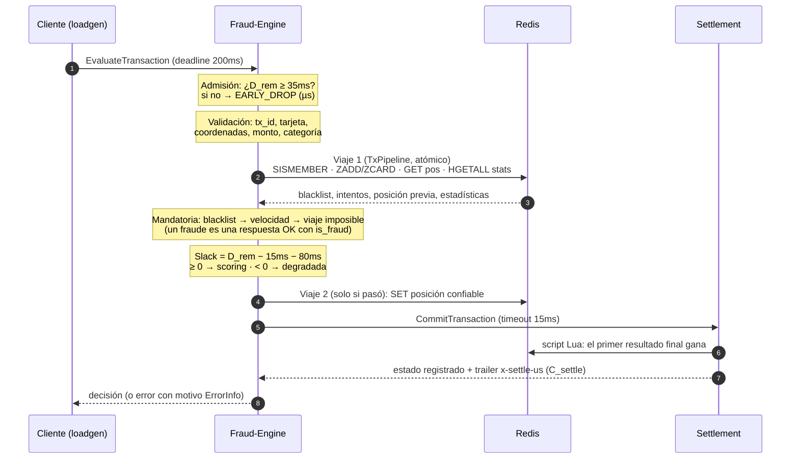
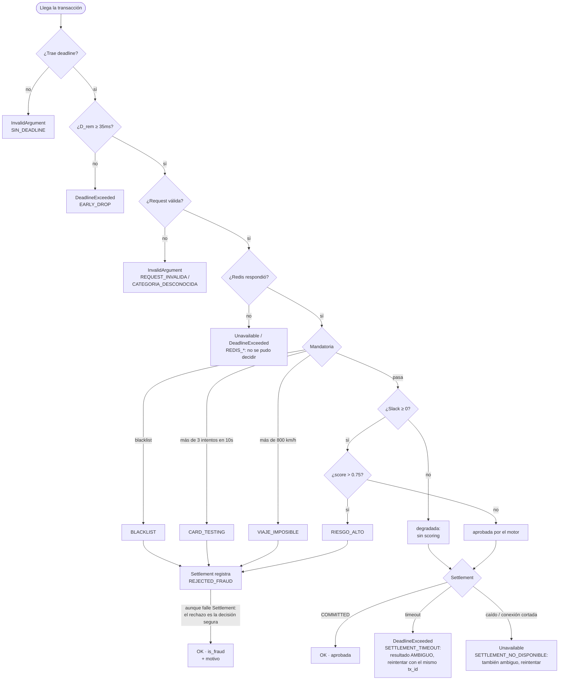
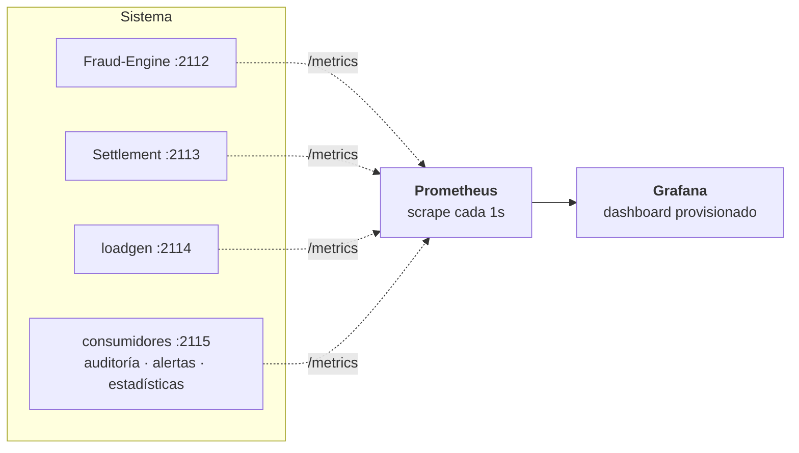

# D-RTS — Detección de fraude en tiempo real con deadline duro

**D-RTS** (*Distributed Real-Time Fraud Detection System*) es un motor de
autorización de pagos que decide si aprueba o rechaza cada transacción bajo un
**deadline duro de 200ms de extremo a extremo**. Está escrito en Go, sobre
gRPC y Redis, con un segundo servicio (Settlement), un generador de carga
propio y observabilidad con Prometheus y Grafana.

Es el proyecto de la materia *Sistemas en Tiempo Real*. Cada decisión de
diseño está registrada como un ADR en [`docs/adr/`](docs/adr/README.md).

---

## Índice

- [¿Por qué este proyecto?](#por-qué-este-proyecto)
- [El modelo de tiempo real](#el-modelo-de-tiempo-real)
- [Arquitectura](#arquitectura)
- [Recorrido de una transacción](#recorrido-de-una-transacción)
- [Componentes](#componentes)
- [Estructura del repositorio y por qué](#estructura-del-repositorio-y-por-qué)
- [Decisiones de diseño (ADRs)](#decisiones-de-diseño-adrs)
- [Lo que mostraron las mediciones](#lo-que-mostraron-las-mediciones)
- [Cómo correrlo](#cómo-correrlo)
- [Configuración](#configuración)
- [Observabilidad](#observabilidad)
- [Tests](#tests)
- [Estado y próximos pasos](#estado-y-próximos-pasos)
- [Referencias](#referencias)

---

## ¿Por qué este proyecto?

En un sistema *best-effort* una respuesta lenta es solo una respuesta lenta.
En un sistema de **tiempo real duro**, una respuesta correcta que llega tarde
**es una falla**. Autorizar un pago es un buen ejemplo: la red de tarjetas le
da al emisor un plazo, y si el motor de fraude no decide a tiempo, la
transacción se pierde o se decide sin él.

El proyecto explora tres preguntas:

1. **¿Cómo se diseña un motor que priorice cumplir el deadline?** Rechazando
   temprano lo que no va a llegar (*load shedding*) y separando el trabajo en
   una parte obligatoria y una opcional que se saltea si no hay tiempo
   (*Computación Imprecisa*, Liu et al., 1991).
2. **¿Qué pasa con ese diseño bajo carga real y con fallas reales?** Redis
   caído, un segundo servicio lento, timeouts cuyo resultado es desconocido,
   saturación de CPU.
3. **¿Qué tan estables son la latencia y el cumplimiento del deadline según
   dónde corre el sistema?** El mismo artefacto se mide en binarios nativos,
   en Docker Compose y en la nube ([ADR-0018](docs/adr/0018-evaluar-en-distintos-entornos.md)).

Todo corre sobre **infraestructura real**: no hay Redis falsos ni mocks
([ADR-0016](docs/adr/0016-tests-contra-infraestructura-real.md)).

## El modelo de tiempo real

Cada transacción es $T_i = (a_i, M_i, O_i, D_i)$, con deadline
$D_i = a_i + 200\,ms$.

| Pieza | Qué es | Presupuesto de diseño |
|---|---|---|
| **Fase mandatoria** $M_i$ | blacklist, control de velocidad (más de 3 intentos en 10s = *card testing*), viaje imposible (más de 800 km/h entre dos compras) | $WCET(M) = 20\,ms$ |
| **Fase opcional** $O_i$ | scoring de riesgo: Z-score sobre $\ln(\text{monto})$ ponderado por categoría de comercio | $WCET(O) = 80\,ms$ |
| **Settlement + red** | registrar el resultado en el segundo servicio | $C_{settle} + C_{net} = 15\,ms$ |

Dos decisiones temporales gobiernan cada transacción:

- **Admisión** (al llegar, antes de cualquier trabajo):
  $D_{rem} = deadline - ahora$. Si $D_{rem} < WCET(M) + C_{settle} + C_{net}$
  (35ms), se rechaza en el acto
  ([ADR-0003](docs/adr/0003-control-de-admision-temprano.md)).
- **Slack** (después de la mandatoria):
  $S_i = D_{rem} - C_{settle} - C_{net} - WCET(O)$. Si $S_i \geq 0$ corre el
  scoring; si no, la respuesta sale solo con la mandatoria y marcada como
  degradada ([ADR-0004](docs/adr/0004-computacion-imprecisa.md)).

Los presupuestos son **puntos de partida de diseño**, no mediciones: se
recalibran midiendo en cada entorno. Viven en un solo lugar,
[`internal/presupuesto`](internal/presupuesto/presupuesto.go), para que la
admisión y el slack no puedan contradecirse.

## Arquitectura

El sistema se lee en tres capas, en el orden en que las recorre una
transacción. Las flechas llenas son sincrónicas (cuentan contra el deadline);
las punteadas son asíncronas (no lo tocan).


1. **Camino de decisión (sincrónico, ≤ 200ms).** El cliente llama al
   Fraud-Engine con un deadline; el motor decide y liquida con Settlement
   antes de responder. El deadline viaja de punta a punta en el
   `context.Context` y en el header `grpc-timeout`: es lo que da el **flujo
   completo acotado**, porque dentro de los 200ms el cliente sabe el
   resultado final, o sabe que no lo sabe
   ([ADR-0002](docs/adr/0002-camino-de-decision-sincronico-con-grpc.md)).
2. **Datos.** Redis guarda el estado que el camino de decisión consulta y
   escribe (en un solo viaje por transacción,
   [ADR-0008](docs/adr/0008-redis-un-viaje-atomico.md)). Kafka recibe los
   eventos de lo que pasó, en protobuf
   ([ADR-0024](docs/adr/0024-eventos-en-protobuf-sin-bloquear.md)).
3. **Cold path (asíncrono, sin deadline).** Consumidores que procesan los
   eventos a su ritmo: auditoría (cruza lo que respondió el motor con lo que
   registró Settlement), estadísticas en vivo en modo sombra y alertas de
   fraude. Publicar **nunca bloquea**: con Kafka caído, el camino de decisión
   da igual ([ADR-0019](docs/adr/0019-kafka-como-columna-de-eventos.md)). La
   auditoría escribe un archivo JSONL por día y hace visibles las
   discrepancias, como la *ambigua comprometida*: el cliente recibió error,
   pero la transacción se comprometió
   ([ADR-0025](docs/adr/0025-consumidores-y-auditoria.md)).

Dos reglas atraviesan todo: **fail-closed** (si no se puede verificar, no se
aprueba, [ADR-0009](docs/adr/0009-fail-closed-y-fallo-rapido.md)) y
**idempotencia por `tx_id`** (reintentar una transacción no cambia su
resultado, [ADR-0013](docs/adr/0013-ambiguedad-del-timeout-e-idempotencia.md)).

En Docker Compose cada capa vive en su propia red privada (`aplicacion`,
`datos`, `observabilidad`), y los servicios se conectan solo a las que
necesitan, como security groups en una VPC
([ADR-0023](docs/adr/0023-redes-como-subredes-privadas.md)).

La observabilidad (métricas, dashboard) es transversal y se describe en su
[propia sección](#observabilidad).

## Recorrido de una transacción



Los resultados posibles, del lado del cliente:



Por qué un fraude es una respuesta `OK` y no un error, y cómo se distinguen
los motivos: [ADR-0005](docs/adr/0005-fraude-no-es-error.md). Por qué un
timeout esperando a Settlement es "resultado desconocido" y cómo se resuelve:
[ADR-0013](docs/adr/0013-ambiguedad-del-timeout-e-idempotencia.md).

## Componentes

### Binarios (`cmd/`)

| Binario | Qué hace | ADRs |
|---|---|---|
| [`server`](cmd/server/main.go) | **Fraud-Engine.** Admisión, validación, fase mandatoria contra Redis, slack, fase opcional y liquidación con Settlement. Puerto gRPC `:50051`, métricas `:2112`. | 0002–0009, 0012, 0013 |
| [`settlement`](cmd/settlement/main.go) | **Settlement.** Registra cada decisión (`COMMITTED`, `REJECTED_FRAUD`, `ABORTED_TIMEOUT`) de forma idempotente y calcula la latencia de extremo a extremo. Puerto `:50052`, métricas `:2113`. | 0012, 0013 |
| [`loadgen`](cmd/loadgen/main.go) | **Generador de carga** de lazo abierto (llegadas de Poisson). Tasa fija o un **perfil del día** con picos ([`perfiles/`](perfiles/)). Mide la latencia desde el instante programado, clasifica resultados y reintenta los ambiguos. Métricas `:2114`. | 0014, 0026 |
| [`cargar-stats`](cmd/cargar-stats/main.go) | Calcula media, desvío y peso de riesgo por categoría (algoritmo de Welford) desde el dataset y los guarda en Redis. | 0010 |
| [`salud`](cmd/salud/main.go) | Chequeo de salud por gRPC para contenedores sin shell. | 0020 |
| [`eventos`](cmd/eventos/main.go) | **Consumidores del cold path**, un rol por contenedor: `auditoria` (cruza los dos topics y detecta discrepancias), `alertas`, `estadisticas` (modo sombra) y `volcar` (muestra los eventos como JSON). | 0025 |

### Paquetes (`internal/`)

| Paquete | Responsabilidad |
|---|---|
| [`presupuesto`](internal/presupuesto/presupuesto.go) | El modelo temporal: deadline global, WCETs, reserva, `Admitir`, `Slack`, `CorreOpcional`. Funciones puras. |
| [`mandatoria`](internal/mandatoria/mandatoria.go) | Fase mandatoria contra Redis en un solo viaje (`TxPipeline`): blacklist, ventana de velocidad (ZSET), posición confiable, Haversine. |
| [`opcional`](internal/opcional/opcional.go) | Scoring: Z-score sobre ln(monto) ponderado por categoría, con costo de CPU simulado configurable. |
| [`settlement`](internal/settlement/settlement.go) | El servicio Settlement: registro con script Lua ("el primer resultado final gana"), con TTL, y trailer con su tiempo interno. |
| [`eventos`](internal/eventos/eventos.go) | Productor de eventos que nunca bloquea (`TryProduce`, buffer acotado, descartes contados). |
| [`consumo`](internal/consumo/consumo.go) | Bucle de consumo "al menos una vez" (confirma después de procesar) con métrica de lag. |
| [`auditoria`](internal/auditoria/auditoria.go) | Cruce de los dos topics por `tx_id` con ventana, clasificación pura y archivo JSONL por día. |
| [`estadisticas`](internal/estadisticas/estadisticas.go) | Media y desvío en una pasada (Welford), compartido por la línea base y las estadísticas en vivo. |
| [`fallas`](internal/fallas/fallas.go) | Motivos de error (`google.rpc.ErrorInfo`): el contrato de errores con los clientes. |
| [`metricas`](internal/metricas/metricas.go) | Interceptor gRPC (tasa, errores, latencia, en vuelo, respuestas tardías) y métricas del modelo temporal. |
| [`redisclient`](internal/redisclient/redisclient.go) | Cliente de Redis con la configuración del hot path: respeta el deadline del `ctx` y no reintenta. |
| [`servicio`](internal/servicio/servicio.go) | Ciclo de vida: salud gRPC estándar y apagado ordenado ante SIGTERM. |
| [`config`](internal/config/config.go) | Configuración desde variables de entorno, con validación al arrancar. |
| [`registro`](internal/registro/registro.go) | Logs estructurados (`log/slog`) con niveles, desde el entorno. |
| [`pruebas`](internal/pruebas/pruebas.go) | Helpers de los tests: Redis real con prefijo único y servidores gRPC reales en puertos reales. |

### Contrato

[`proto/transactions.proto`](proto/transactions.proto) define dos servicios:
`FraudEngine.EvaluateTransaction` y `Settlement.CommitTransaction`.
[`proto/eventos.proto`](proto/eventos.proto) define los eventos de Kafka
(`TransaccionEvaluada`, `TransaccionLiquidada`), que reusan los mensajes del
contrato. El código generado está versionado; se regenera con `make proto`
solo si cambia un `.proto`.

## Estructura del repositorio y por qué

```
.
├── proto/                 contrato gRPC + código generado
├── cmd/                   un directorio por binario: solo arma las piezas
│   ├── server/            Fraud-Engine
│   ├── settlement/        Settlement
│   ├── loadgen/           generador de carga
│   ├── cargar-stats/      estadísticas del scoring → Redis
│   ├── salud/             chequeo de salud para contenedores
│   └── eventos/           consumidores del cold path (un rol por contenedor)
├── internal/              toda la lógica (no importable desde afuera del módulo)
├── observabilidad/        Prometheus y Grafana, provisionados desde archivos
├── perfiles/              curvas de carga del día para el loadgen (ADR-0026)
├── docs/adr/              decisiones de diseño
├── Dockerfile             una imagen por servicio (--target)
├── docker-compose.yml     el sistema completo, por perfiles
├── Makefile               atajos
├── data/                  dataset (fuera de git; se descarga aparte)
└── auditoria/             registro de auditoría, un JSONL por día (fuera de git)
```

- **`cmd/` solo cablea, `internal/` hace.** Cada binario lee su configuración,
  crea las piezas y las conecta. La lógica vive en `internal/` por dos
  razones: un paquete `main` **no se puede importar** (los tests del motor
  necesitan levantar un Settlement real, y por eso Settlement vive en
  `internal/settlement`), y separar "armar" de "hacer" deja la lógica
  testeable sin red.
- **`internal/` lo hace cumplir el compilador:** solo este módulo puede
  importar esos paquetes. Es la API privada del proyecto.
- **Un paquete por responsabilidad, sin interfaces de más.** Hay una sola
  implementación de cada cosa (por ejemplo, un solo almacén: Redis), así que
  no hay interfaces "por si acaso". El modelo temporal está aislado en
  `presupuesto` como funciones puras: se testea a 1µs de los bordes sin
  depender del reloj.
- **Un solo `Dockerfile`** con una salida por servicio: los mismos binarios,
  compilados con la misma versión de Go que los nativos, en imágenes
  distroless de 32–49MB, sin shell y no-root
  ([ADR-0020](docs/adr/0020-imagenes-salud-y-compose.md)).
- **La observabilidad es código:** el dashboard y el datasource se cargan
  desde archivos versionados; se levanta sin configurar nada
  ([ADR-0015](docs/adr/0015-observabilidad-prometheus-grafana.md)).
- **El dataset no se versiona ni va en las imágenes:** pesa ~500MB y se monta
  como volumen.

## Decisiones de diseño (ADRs)

Índice completo con estado y etapa: [`docs/adr/README.md`](docs/adr/README.md).

| Tema | ADRs |
|---|---|
| **Modelo de tiempo real** | [0002](docs/adr/0002-camino-de-decision-sincronico-con-grpc.md) camino sincrónico con deadline propagado · [0003](docs/adr/0003-control-de-admision-temprano.md) admisión temprana · [0004](docs/adr/0004-computacion-imprecisa.md) computación imprecisa · [0011](docs/adr/0011-costo-simulado-y-wcet.md) peor caso, no promedio |
| **Correctitud ante fallas** | [0005](docs/adr/0005-fraude-no-es-error.md) un fraude no es un error · [0009](docs/adr/0009-fail-closed-y-fallo-rapido.md) fail-closed y fallo rápido · [0012](docs/adr/0012-settlement-segundo-servicio-sincronico.md) Settlement con timeout propio · [0013](docs/adr/0013-ambiguedad-del-timeout-e-idempotencia.md) ambigüedad del timeout e idempotencia · [0022](docs/adr/0022-conexion-caida-es-resultado-ambiguo.md) conexión caída = ambiguo |
| **Detección** | [0006](docs/adr/0006-que-se-registra-ante-un-rechazo.md) qué se registra ante un rechazo · [0007](docs/adr/0007-validacion-estricta-de-la-request.md) validación · [0008](docs/adr/0008-redis-un-viaje-atomico.md) Redis en un viaje atómico · [0010](docs/adr/0010-modelo-de-scoring.md) scoring |
| **Cold path (Kafka)** | [0019](docs/adr/0019-kafka-como-columna-de-eventos.md) Kafka al costado · [0023](docs/adr/0023-redes-como-subredes-privadas.md) redes como subredes privadas · [0024](docs/adr/0024-eventos-en-protobuf-sin-bloquear.md) eventos en protobuf sin bloquear · [0025](docs/adr/0025-consumidores-y-auditoria.md) consumidores y auditoría |
| **Medir y operar** | [0014](docs/adr/0014-load-generator-de-lazo-abierto.md) generador de lazo abierto · [0015](docs/adr/0015-observabilidad-prometheus-grafana.md) observabilidad · [0016](docs/adr/0016-tests-contra-infraestructura-real.md) tests reales · [0017](docs/adr/0017-configuracion-por-entorno-y-apagado-ordenado.md) configuración y apagado · [0018](docs/adr/0018-evaluar-en-distintos-entornos.md) evaluar por entornos · [0020](docs/adr/0020-imagenes-salud-y-compose.md) imágenes, salud y Compose · [0021](docs/adr/0021-logs-con-niveles.md) logs con niveles |

## Lo que mostraron las mediciones

Medido en la notebook de desarrollo (Intel i7-12650H, 16 hilos), todo en la
misma máquina y con el cargador conectado. Son datos de **ese** entorno; la
comparación formal entre entornos está en curso. Ojo: a batería, el CPU baja
a menos de la mitad de su frecuencia y la latencia se duplica, así que el
estado de energía es parte de cada medición.

| Qué | Resultado |
|---|---|
| Fase mandatoria: 6 comandos a Redis | uno por uno: P50 133µs · con `TxPipeline`: **P50 27µs** (≈ 1 viaje) |
| Red entre motor y Settlement (`C_net`) | P50 0.34ms, P99 0.68ms, contra 15ms reservados |
| Scoring con 40M iteraciones de costo simulado | media 65ms (entra en 80ms) pero **P99 81ms** (no entra): por eso se presupuesta por peor caso |
| Redis caído | sin reintentos: `Unavailable` en **~1ms**; con los reintentos por defecto de go-redis, 200ms |
| Carga de 350 RPS | **100%** dentro del deadline, P99 44ms |
| Carga de 700 / 1400 RPS | 56% / 11% dentro del deadline: **colapso por congestión** (el goodput cae de ~205/s a ~62/s) |
| Sistema completo en Docker Compose, 300 RPS | 100% dentro del deadline, P50 19ms, P99 31ms |
| Apagado con SIGTERM a mitad de carga | **0** transacciones en vuelo perdidas (con SIGKILL se cortan todas a la vez) |
| Kafka arriba / caído / deshabilitado, 300 RPS | el camino de decisión da **igual** en los tres (100%, P50 ~19ms); con Kafka caído los eventos esperan en el buffer |
| Auditoría en Compose, 300 RPS | detectó **99 ambiguas comprometidas** que antes eran invisibles |

El colapso por congestión es el hallazgo más importante hasta ahora: sin una
cola delante del handler, toda request pasa la admisión con ~200ms y después
todas compiten por el CPU y vencen juntas. La admisión solo protege si hay
espera que consuma $D_{rem}$
([ADR-0003](docs/adr/0003-control-de-admision-temprano.md)).

## Cómo correrlo

### Requisitos

- Go 1.27 o superior.
- Docker con Compose v2.
- El dataset *Credit Card Transactions Fraud Detection* (Sparkov, licencia
  CC0) en `data/`. Con la CLI de Kaggle:

  ```sh
  kaggle datasets download -d kartik2112/fraud-detection -p data/ --unzip
  ```

### Opción A: todo en Docker Compose

```sh
make sistema-up                                   # Redis, Kafka, Settlement, Fraud-Engine, consumidores + Prometheus y Grafana
make carga-compose ARGS="-rps 300 -duracion 30s"  # carga dentro del Compose
make sistema-down                                 # bajar todo
```

El orden de arranque lo dan los chequeos de salud: Redis → carga de
estadísticas (un contenedor que corre una vez y termina) → Settlement →
Fraud-Engine. Kafka y sus topics arrancan en paralelo: el motor no depende de
ellos. La auditoría queda en `auditoria/AAAA-MM-DD.jsonl`; para ver los
eventos en vivo, `make volcar`.

### Opción B: binarios nativos

```sh
docker run -d --name redis-drts -p 6379:6379 redis   # Redis
make cargar-stats                                    # estadísticas del scoring
make run-settlement                                  # en una terminal
make run-server                                      # en otra
make carga-nominal                                   # 50 RPS, 30s
go run ./cmd/loadgen -rps 700 -duracion 30s          # o cualquier tasa
make kafka-up                                        # Kafka (opcional; los servicios usan KAFKA_BROKERS=localhost:9092)
make obs-up                                          # Prometheus + Grafana (opcional)
```

Cada corrida del generador imprime un resumen (P50/P99/P100 por categoría, %
dentro del deadline) y deja un CSV por transacción en `resultados/`.

### Un día de carga (perfil con picos)

```sh
make carga-compose ARGS="-perfil perfiles/dia-habil.csv -rps 800"                # el día entero en 24 min
make carga-compose ARGS="-perfil perfiles/dia-habil.csv -rps 800 -desde 11 -hasta 14 -compresion 360"  # solo el mediodía, en 30s
```

La tasa sigue una curva del día (madrugada baja, mañana estable, picos al
mediodía y a las 19h): un proceso de Poisson no homogéneo
([ADR-0026](docs/adr/0026-perfil-de-carga-diario.md)). `-rps` es la tasa
del pico y `-compresion 60` hace que 1 hora del perfil dure 1 minuto. Al
final se imprime, además, un resumen **por franja horaria**: el pico es lo
que importa.

## Configuración

Por variables de entorno ([ADR-0017](docs/adr/0017-configuracion-por-entorno-y-apagado-ordenado.md)).
Los valores por defecto sirven para correr en una sola máquina. Un valor mal
escrito impide arrancar.

| Variable | Fraud-Engine | Settlement | Para qué |
|---|---|---|---|
| `GRPC_ADDR` | `:50051` | `:50052` | dónde escucha |
| `METRICAS_ADDR` | `:2112` | `:2113` | `/metrics` (`""` = no exponer) |
| `REDIS_ADDR` | `localhost:6379` | `localhost:6379` | Redis |
| `REDIS_PREFIJO` | `drts:` | `drts:` | prefijo de las claves (permite compartir un Redis) |
| `SETTLEMENT_ADDR` | `localhost:50052` | — | Settlement |
| `ITERACIONES_SCORING` | `10000000` | — | costo de CPU simulado del scoring (~16ms) |
| `APAGADO_ESPERA` | `5s` | `5s` | máximo para terminar las requests en vuelo |
| `APAGADO_AVISO` | `0s` | `0s` | tiempo en `NOT_SERVING` antes de dejar de atender (detrás de un balanceador) |
| `LOG_NIVEL` | `info` | `info` | `debug` agrega una línea por transacción ([ADR-0021](docs/adr/0021-logs-con-niveles.md)) |
| `LOG_FORMATO` | `texto` | `texto` | `json` para la nube |
| `KAFKA_BROKERS` | `""` | `""` | brokers de Kafka; vacío = eventos deshabilitados (el sistema funciona igual) |
| `SETTLEMENT_TTL` | — | `24h` | cuánto vive cada registro de Settlement en Redis (mientras se pueda reintentar) |

El generador de carga se configura por flags: `go run ./cmd/loadgen -h`.

## Observabilidad



`make obs-up` (o `make sistema-up`) levanta Prometheus (http://localhost:9090)
y Grafana (http://localhost:3000, sin login, solo en `localhost`). El
dashboard **"D-RTS — Tiempo real"** se lee de arriba hacia abajo:

1. **Lo que ve el cliente:** % dentro del deadline, carga ofrecida vs
   *goodput*, resultados por categoría, latencia con la línea de los 200ms.
2. **Por qué:** requests en vuelo, respuestas tardías (el servidor no se
   entera de un *deadline miss*: esta métrica lo deja ver), $D_{rem}$ al
   llegar, slack, decisiones, duración de cada fase.
3. **Settlement:** estados registrados y latencia de extremo a extremo.
4. **Runtime de Go y CPU:** núcleos por proceso, pausas del GC, goroutines.
5. **Cold path (Kafka):** eventos publicados y descartados, buffer del
   productor, lag de cada consumidor, resultado de la auditoría (con las
   discrepancias contadas aparte), alertas por motivo y deriva de las
   estadísticas en sombra. Con Kafka caído, las filas 1–4 no cambian: es la
   forma de verlo.

Prometheus scrapea las dos formas de correr el sistema con la etiqueta
`entorno` (`nativo` / `compose`), con el mismo dashboard. El interceptor de
métricas cuesta ~120ns por request.

## Tests

```sh
docker start redis-drts    # los tests usan Redis real
make kafka-up              # y Kafka real
go test -race ./...
```

Los tests usan **Redis real**, **Kafka real** y **servidores gRPC reales** en
puertos reales. Si falta alguno, fallan con un mensaje que dice cómo levantarlo
(no se saltean: un test salteado se ve "ok"). `REDIS_ADDR` permite apuntar a
otro Redis. Algunos tests reproducen fallas con infraestructura real
modificada: un Settlement que tarda, uno que compromete y "pierde" la
respuesta, un puerto donde no escucha nadie.

## Estado y próximos pasos

| Etapa | Estado |
|---|---|
| Admisión, fase mandatoria, Redis, slack y fase opcional, Settlement, generador de carga, observabilidad | ✅ |
| Contenedores: configuración por entorno, apagado ordenado, salud, Compose | ✅ |
| Kafka como columna de eventos: Kafka, redes privadas, eventos en protobuf publicados sin bloquear | ✅ ([ADR-0023](docs/adr/0023-redes-como-subredes-privadas.md), [ADR-0024](docs/adr/0024-eventos-en-protobuf-sin-bloquear.md)) |
| Consumidores: auditoría con detección de discrepancias, estadísticas en vivo (sombra), alertas; TTL en Settlement | ✅ ([ADR-0025](docs/adr/0025-consumidores-y-auditoria.md)) |
| Experimento: Kafka en el camino de decisión (modo asíncrono) | planificado |
| Nube (AWS) | planificado |
| Calibración por entorno: pool de workers contra el colapso por congestión, pausas del GC, comparación nativo / Compose / nube | planificado |

## Referencias

- J. W. S. Liu, K.-J. Lin, W.-K. Shih, A. C. Yu, J.-Y. Chung y W. Zhao (1991).
  *Algorithms for Scheduling Imprecise Computations*. IEEE Computer.
- Dataset: *Credit Card Transactions Fraud Detection* (Kartik Shenoy, generado
  con Sparkov), Kaggle, licencia CC0. Sintético: no contiene datos reales de
  personas.
- Formato de los ADRs: Michael Nygard, *Documenting Architecture Decisions*.
